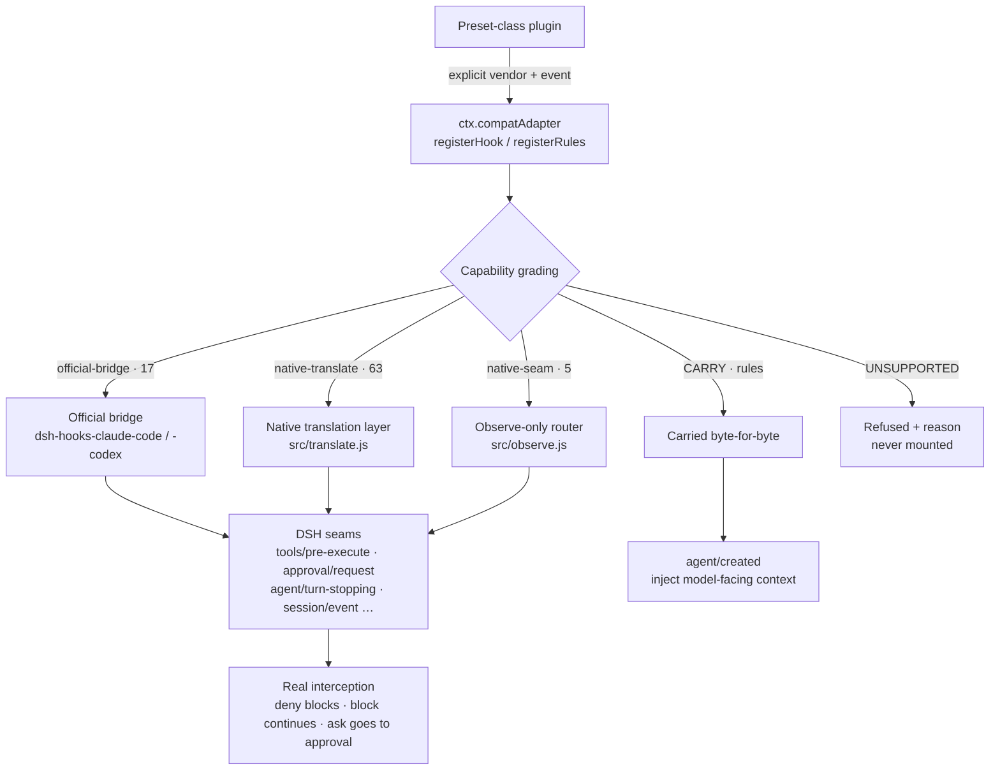

<div align="center">

<h1>dsh-compat-adapter</h1>

<p><b>Make Claude Code / Codex / WorkBuddy / OpenCode / Copilot hooks and rules actually run inside DSH.</b></p>

<p>A DSH pre-adapter plugin: <b>declare explicitly → grade capability → route to a real seam</b>.<br/>No guessing, no pretending it works, no foreign plugin runtime inside the Host.</p>

<p>
  <a href="INTEGRATION.md"><b>🔌 I want to use it</b></a> — how another plugin calls this adapter (consumer guide)
</p>

<p>
  <b>English</b> ·
  <a href="README.md"><b>简体中文</b></a>
</p>

<p>
  <a href="LICENSE"></a>
  <a href="#verification"></a>
  
  =24">
  
  
  
</p>

</div>

---

## What this is

DSH (DeepSeek Harness) is a new agent runtime. Meanwhile you already have a working set of hooks and rules in Claude Code, Codex, WorkBuddy, OpenCode and GitHub Copilot — the "block this before it writes a file", "add context after that tool call", "run a script when the session ends" machinery.

The cheap way to move them to DSH is to wire them up by name. That breaks silently:

> Claude's `updatedInput` gets parsed but never honored;
> Codex's `permissionDecision: "ask"` has no approval path and degrades into an allow;
> Copilot writes its denial at the **top level**, while DSH's hook parser only reads `hookSpecificOutput` — so reusing it directly means **every Copilot deny is silently read as "no decision" and let through**;
> OpenCode plugins are TypeScript callbacks: the *names* line up, the *callback bodies* cannot cross.

**This plugin exists so that every adaptation loss becomes a readable output instead of a working-looking illusion.**

It does exactly three things:

| | |
|---|---|
| **Declare** | The preset author names the vendor and event explicitly. No filename sniffing, no ownership guessing. |
| **Grade** | Every asset returns a frozen four-level result with its losses listed one by one. |
| **Route** | Reuse the official bridge where one exists, really translate where a seam can intercept, say "observe-only" where it cannot, and refuse otherwise. |

### Two things it does not do

- **It does not re-implement the official bridges.** Every event they cover is handed straight to `@deepseek-ai/dsh-hooks-claude-code` / `-codex`. This plugin only turns declarations into bridge config, and decides what happens to the events no bridge covers.
- **It does not execute foreign code.** JS function handlers, OpenCode's TS callback runtime, Claude's `http` / `mcp_tool` / `prompt` / `agent` handlers — all `UNSUPPORTED`. Other agents' plugin runtimes do not get embedded in the DSH Host.

---

## Core design: grades, not booleans

Every registration returns a **frozen** capability result. There is no `supported: true` field flattening the risk away.

| Grade | Meaning | In this version |
| :--- | :--- | :--- |
| `DIRECT` | A 1:1 DSH seam exists; semantics preserved verbatim. | **None.** See below. |
| `ADAPTED` | A DSH seam exists but semantics are lossy; `degradations[]` states each loss. | **All 85 events** |
| `CARRY` | No general mapping; carried byte-for-byte and injected at session start. Never becomes executable policy. | **All 5 vendors' rules** |
| `UNSUPPORTED` | No faithful mapping; rejected with a `reason`. | Procedural boundaries (below) |

### Why nothing claims `DIRECT`

Both official bridges are themselves best-effort dialect adaptations. Claiming byte-faithfulness would be a false capability.

So this plugin marks **not a single row `DIRECT`** — all 85 rows are `ADAPTED`, and every row must state its own losses. That is not pessimism, it is honesty: `test/matrix-readme.test.js` asserts `DIRECT.length === 0` and asserts that every `ADAPTED` row carries at least one degradation.

> **Full coverage is not equivalence.** All 85 events are executable (0 refusals), but that is coverage where *every row states its losses* — not a claim that they all behave identically.

### Four hard invariants (enforced by tests, not by documentation)

| Invariant | Enforced by |
| :--- | :--- |
| `ADAPTED` **must** list at least one `degradations` entry, or construction throws | `capabilityResult()` + `test/capability.test.js` |
| `UNSUPPORTED` **must** carry a `reason`, or construction throws | `capabilityResult()` + `test/capability.test.js` |
| An unknown vendor / event **throws** (`UNKNOWN_VENDOR` / `UNKNOWN_EVENT`); never a silent fallback | `test/service.test.js` |
| An `UNSUPPORTED` asset is **never mounted**: no config written, no bridge mounted, absent from `status()`'s executable list | `test/service.test.js` + `verify:live` |

So what are the real `UNSUPPORTED` paths left, now that every event is executable?

- **JS function handlers** — foreign code is not executed in the Host.
- **Missing `ctx.shell`** — no shell executor in the composition, so command hooks cannot run; rules still work (they only read files and inject context).
- **Missing official bridge package** — if `dsh-hooks-*` does not resolve from the profile, the registration is refused rather than falling back to a homegrown implementation.
- **Non-command handlers** — `http` / `mcp_tool` / `prompt` / `agent` throw `INVALID_HANDLER`.

---

## Supported vendors

Five independent adapters. Each is a pure data module (`src/vendors/<vendor>.js`): no I/O, no DSH imports, so the whole matrix is unit-testable without a Harness.

| Vendor | Aliases | Official bridge | Events | Bridged | Translated | Observe-only | rules |
| :--- | :--- | :--- | ---: | ---: | ---: | ---: | :---: |
| `claude` | `claude-code`, `cc` | `dsh-hooks-claude-code` | 32 | 7 | 23 | 2 | CARRY |
| `codex` | `openai-codex` | `dsh-hooks-codex` | 12 | 5 | 4 | 3 | CARRY |
| `workbuddy` | `codebuddy` | `dsh-hooks-claude-code` | 24 | 5 | 19 | 0 | CARRY |
| `opencode` | — | **none** | 5 | 0 | 5 | 0 | CARRY |
| `copilot` | `github-copilot` | **none** | 12 | 0 | 12 | 0 | CARRY |
| **Total** | | | **85** | **17** | **63** | **5** | |

Three things that are easy to misread:

- **`workbuddy`** — the WorkBuddy desktop app **has no public hook API**. This adapter treats declarations as CodeBuddy-engine hooks (which Tencent documents as Claude-Code compatible) and writes "no desktop API", "`CODEBUDDY_PROJECT_DIR` is not exported" and "`modifiedInput` is not read" into *every* degradation row, asserted by tests.
- **`opencode`** — all 5 callback names map to DSH seams, but the **TS callback bodies are not carried**; they must be re-authored as commands. That is explicitly out of scope, not forgotten.
- **`copilot`** — DSH ships no Copilot bridge, so all 12 events are **translated by this plugin itself**: deny really blocks, block really forces another turn, subagents really receive context, approvals really decide. See [Copilot's special path](#copilots-special-path).

---

## How it works



The difference between the three routes is exactly **whether a decision reaches DSH**:

| Route | Decision takes effect | Used for |
| :--- | :--- | :--- |
| `official-bridge` | ✅ mapped by the official bridge | vendors that have a bridge |
| `native-translate` | ✅ this plugin produces the DSH decision type directly | no bridge, but the seam can intercept |
| `native-seam` | ❌ **observe-only**; a blocking attempt is logged and ignored | lifecycle moments with no veto |

---

## Installation

A standard DSH Cordis bundle (`dsh.bundle.patch` in `package.json` + `cordis.patch.yml`).

```bash
# Option A: the plugin_manager tool (managed path, recommended)
#   action: install_bundle, target: <absolute path to this repo>

# Option B: CLI
dsh plugin --profile <profile> add <absolute path to this repo>
```

Once installed the plugin does one thing: it provides the `ctx.compatAdapter` service. **It adapts nothing by itself** — adaptation is triggered by preset plugins declaring assets.

<details>
<summary><b>⚠️ One pitfall you must know: the <code>name</code> in <code>cordis.patch.yml</code> must be a bare specifier</b></summary>

A bundle patch's `baseUrl` is the **profile root**, not the directory of the patch file. A relative path or a `node_modules/<pkg>/` prefix will fail to resolve.

```yaml
# ✅ correct
- insert:
    - id: compat-adapter
      name: 'dsh-compat-adapter'
```

`test/index.test.js` asserts this (after stripping comments, so the counter-example in the prose is not mistaken for patch content).

</details>

### Using it from a preset-class plugin

Insert this plugin into your preset's `plugins` list (order is guaranteed by `inject`), then call the service from your own `apply()`:

```yaml
- insert:
    - id: preset-my-preset
      name: '@deepseek-ai/dsh-agent-preset'
      config:
        id: my-preset
        name: My Preset
        plugins:
          - id: compat-adapter
            name: 'dsh-compat-adapter'
          - id: my-vendor-assets
            name: './my-vendor-assets/index.js'
```

```js
// my-vendor-assets/index.js
export const name = 'my-vendor-assets'
export const inject = ['compatAdapter']

// apply may be async: Cordis awaits it, and registrations must happen during setup.
export async function apply(ctx) {
  // ── hooks ──────────────────────────────────────────────────────────────
  const r = await ctx.compatAdapter.registerHook({
    vendor: 'claude',                        // explicit; never detected
    event: 'PreToolUse',
    matcher: 'Write',                        // vendor matcher semantics, passed through
    handler: 'node ./hooks/no-write.mjs',    // a command string = a command hook
  })
  // r.capability === 'ADAPTED'
  // r.seams      === ['tools/pre-execute']
  // r.degradations === [... one loss per entry ...]

  // ── rules ──────────────────────────────────────────────────────────────
  const rules = await ctx.compatAdapter.registerRules({
    vendor: 'codex',
    source: 'rules/*.rules',            // absolute / baseDir-relative / file:// / glob
    baseDir: '/abs/path/to/package',    // basis for relative sources; must be absolute
  })
  // rules.capability === 'CARRY'; injected as context at session start
}
```

---

## Public API

### `registerHook(declaration)`

| Field | Required | Notes |
| :--- | :---: | :--- |
| `vendor` | ✅ | `claude` / `codex` / `workbuddy` / `opencode` / `copilot`, or a documented alias |
| `event` | ✅ | Vendor event name (e.g. `PreToolUse`); unknown throws `UNKNOWN_EVENT` |
| `matcher` | — | Vendor matcher string; non-strings throw `INVALID_MATCHER` |
| `handler` | — | Command string, or `{ type: 'command', command, timeoutSec? }`. `http` / `mcp_tool` / `prompt` / `agent` throw `INVALID_HANDLER`; a JS function returns `UNSUPPORTED` |
| `id` | — | Stable id, defaults to `<vendor>:<event>:<n>` |

Returns `Promise<CapabilityResult>` (frozen). **Poor portability does not throw** — only a declaration that cannot be processed at all throws.

### `registerRules(declaration)`

| Field | Required | Notes |
| :--- | :---: | :--- |
| `vendor` | ✅ | As above |
| `source` | ✅ | String or array of strings: absolute path, `baseDir`-relative path, `file://` URL, or glob |
| `baseDir` | — | Basis for relative sources; must be absolute (otherwise `INVALID_DECLARATION`) |
| `id` | — | Stable id, defaults to `<vendor>:rules:<n>` |

Returns `Promise<CapabilityResult>` with `capability === 'CARRY'` and `seams === ['agent/created']`.

**Rules semantics** — files are **read and carried byte-for-byte at registration** (with `sha256` and `bytes`), then injected on `agent/created` (covering fresh / resume / clear / compact) via `agent.inject(createUserMessage(...))` as model-facing context. The injected message's `source.kind` is `compat-adapter-rules`, distinguishable from DSH's own `agent-instructions` and traceable in logs.

> **Rules are never a security boundary.** All `CARRY`. Codex's Starlark rules in particular are a command-policy DSL with no DSH equivalent — this adapter injects them as *documentation of the original tool policy*, never translating or enforcing them. Any expectation that "rules will block something" is wrong; to enforce, write a native DSH plugin on `tools/pre-execute`.

### Other methods

| Method | Purpose |
| :--- | :--- |
| `matrix()` | The static capability matrix (what this version can *ever* do). |
| `status()` | Runtime audit (what is *actually live now*): each hook's grade / seams / bridge, rule file paths / bytes / sha256, and whether `shell` / `sessionProjections` exist in this composition. |
| `dispose()` | Unload every bridge and listener; later registrations throw `ADAPTER_DISPOSED` rather than half-working. |

### Config (`config` on the `cordis.patch.yml` row)

| Field | Default | Notes |
| :--- | :--- | :--- |
| `logRegistrations` | `true` | One structured log line per graded registration |
| `failClosed` | `true` | Refuse registrations whose seam is missing instead of mounting a no-op |
| `targetDshVersion` | `0.2.0-rc.2` | Target DSH version; a mismatch errors or warns per `failClosed` |
| `maxRuleBytes` | `524288` | Per-file carry cap; exceeding it **errors** rather than silently truncating |

---

## Blocking contract

"Exit code 2 means block", as documented by the reference tools, is **not dependable** through this DSH version's two official bridges (it can be recorded as `decision: 'pass'` and let the tool through). So this adapter standardizes on:

> **stdout `hookSpecificOutput.permissionDecision` (`deny` / `ask`) with exit code `0`.**

```bash
#!/usr/bin/env bash
# Deny a write: deny + exit 0
printf '%s' '{"hookSpecificOutput":{"hookEventName":"PreToolUse","permissionDecision":"deny","permissionDecisionReason":"no writes in this preset"}}'
exit 0
```

Every example, test and document this plugin generates uses that one form; it **never generates an exit-2 handler**. `permissionDecisionOutput()` in `src/vendors/shared.js` is the single generation entry point, and tests assert the output contains `permissionDecision` and **no** legacy top-level `decision` field.

`ask` maps to DSH's `{kind:'ask'}` and `deny` to `{kind:'deny'}` (through the official bridge, not this plugin). **Exit 2 is still parsed by the bridges** (a hand-written legacy hook is not swallowed), but it is not the contract this plugin promises.

---

## Copilot's special path

GitHub Copilot is the only vendor with **no official DSH bridge** (Claude, Codex and WorkBuddy all reuse a shipped bridge), so its path differs: **this adapter really implements the translation layer** rather than watching from the side.

### Why the hook protocol cannot be reused directly

DSH's `@deepseek-ai/dsh-hook-protocol` only understands the **Claude/Codex dialect**:

```js
// DSH's parser reads only this layer
{ "hookSpecificOutput": { "permissionDecision": "deny", "permissionDecisionReason": "…" } }
```

Copilot writes its decision at the **top level**:

```json
{ "permissionDecision": "deny", "permissionDecisionReason": "…" }
```

Reusing the parser would mean **every Copilot deny is silently treated as "no decision" and allowed through**. So `src/translate.js` has `parseCopilotStdout()` / `normalizeCopilotOutput()`: parse in Copilot's native shape first, then normalize into the internal shape.

That path has dedicated coverage (`test/smoke-copilot.test.js`, 17 cases) and is part of the real-launch `npm run verify:live` assertions.

### Event mapping

| Copilot event | DSH seam | Can block? |
| :--- | :--- | :--- |
| `preToolUse` | `tools/pre-execute` | ✅ deny / ask really take effect |
| `postToolUse` | `tools/post-execute` | forwards `additionalContext` (`modifiedResult` not honored) |
| `subagentStart` | `subagent/start` | ✅ context injected into the **child** agent (via `ctx.agents.get(runId)`) |
| `subagentStop` | `subagent/end` | observe-only (receives `stopReason` / `lastAssistantMessage`) |
| `errorOccurred` | `agent/error` | observe-only (DSH's error path has no verdict channel) |
| `sessionStart` | `agent/created` | injects `additionalContext` as a message |
| `sessionEnd` | `agent/disposed` | observe-only |
| `userPromptSubmitted` | `agent/pre-step` | injects context (cannot rewrite the prompt) |
| `agentStop` | `agent/turn-stopping` | ✅ `decision:"block"` **really forces another turn** (with an 8-block runaway guard) |
| `notification` | `agent/status` | observe-only (DSH publishes status flips, not notification types) |
| `permissionRequest` | `approval/request` | ✅ allow → `allowed-once`, deny → `rejected` |
| `postToolUseFailure` | `tools/post-execute` | fires only when the result is marked as an error |

### Three dialect differences you must know

1. **Matchers are anchored regexes.** Copilot compiles `^(?:PATTERN)$` and requires a full match — `bas` does **not** match `bash`; an invalid regex causes the hook to be **skipped entirely** (not match-all). This adapter implements exactly that.
2. **`allow` is not a pre-approval.** Copilot's `allow` means "don't show a permission prompt", not "force it through", so it is translated to `next()` rather than a short-circuiting allow.
3. **The blocking contract is still stdout + exit 0.** Copilot itself also accepts exit 2 for deny, but this adapter never makes a hook depend on it — one hook body behaves the same across every vendor.

---

## Support matrix

> This section is **generated from code**: `npm run matrix:write` rewrites it from `src/matrix.js`, and `test/matrix-readme.test.js` fails on drift. **Do not edit by hand.**

Three things to keep in mind when reading it:

1. **An `ADAPTED` row's losses are enumerated**, not rhetorical. Claude `PreToolUse`'s `updatedInput` is parsed but not honored; Codex `PreToolUse`'s `ask` has no approval path; Claude `SubagentStart`'s `agent_type` is always `general-purpose`, so a matcher naming a specific agent type never fires.
2. **`native-seam` events are observe-only.** `PreCompact` maps to `compaction/start` on `session/event`, and `SessionEnd` maps to `agent/disposed`. DSH compaction is a service call, not a cancellable waterfall, so it **cannot be vetoed**; a blocking attempt is recorded in the audit log and ignored.
3. **Every WorkBuddy row must state "no public desktop hook API"** — the easiest thing to misread, so it lives in every `degradations` entry and is asserted by tests.

<details>
<summary><b>Expand the full matrix (85 rows with per-row losses)</b></summary>

<!-- MATRIX:START -->

### Hooks: vendor event → DSH seam

| Vendor | Event | Capability | Route | DSH seam(s) | Losses / reason |
| --- | --- | --- | --- | --- | --- |
| claude | `SessionStart` | ADAPTED | official bridge (claude) | agent/created | Runs detached through the bridge, so context can miss the model first request.; Plain-stdout context, initialUserMessage, sessionTitle, watchPaths and CLAUDE_ENV_FILE are not consumed.; Payload omits model, agent_type and session_title. |
| claude | `UserPromptSubmit` | ADAPTED | official bridge (claude) | agent/pre-step | Deny is honored; plain-stdout context, sessionTitle and suppressOriginalPrompt are not.; Unless the hook sets its own timeout the bridge uses its 600s default, not the reference 30s. |
| claude | `PreToolUse` | ADAPTED | official bridge (claude) | tools/pre-execute | deny and ask are honored; allow does not pre-approve and defer is unsupported.; updatedInput is parsed and warned about but not honored.; additionalContext from a PreToolUse hook is ignored. |
| claude | `PostToolUse` | ADAPTED | official bridge (claude) | tools/post-execute | Blocking feedback and additionalContext work; updatedToolOutput and updatedMCPToolOutput do not.; tool_response is flattened to text. |
| claude | `Stop` | ADAPTED | official bridge (claude) | agent/turn-stopping | A blocking Stop forces another step, but stop_hook_active is always false and last_assistant_message is omitted.; There is no consecutive-block cap; an unconditional blocking hook keeps forcing turns. |
| claude | `SubagentStart` | ADAPTED | official bridge (claude) | subagent/start | agent_type is the constant general-purpose; a matcher naming a specific agent type never fires.; Injected context can only reach an in-process child. |
| claude | `SubagentStop` | ADAPTED | official bridge (claude) | subagent/end | Observe-only: cannot block the child or feed it context.; agent_transcript_path, last_assistant_message, background_tasks and session_crons are omitted. |
| claude | `PostCompact` | ADAPTED | native translation (`compaction/end`) | session/event | Observe-only: the compaction already completed, so a hook can react but never change the result.; The summary is taken from the preceding durable `compaction/summary` event; the hook sees the same text, not a live object.; `trigger` is reported as "auto" because DSH does not distinguish a manual /compact from automatic pressure at this seam. |
| claude | `PreCompact` | ADAPTED | native seam, observe-only (`compaction/start`) | session/event | Cannot veto compaction: DSH compaction is a service call, not a cancellable waterfall, so the hook is observe-only.; Fires on the durable compaction/start event after compaction was requested, not before the summary is computed.; A blocking decision (deny / exit 2) is audited but does NOT prevent compaction. |
| claude | `SessionEnd` | ADAPTED | native seam, observe-only (`agent/disposed`) | agent/disposed | agent/disposed fires when an Agent leaves the live registry, which is broader than the reference end-of-session moment (dispose also happens on reload/teardown).; Payload carries no reason and no transcript path; anything the hook needs must be read from the session working directory. |
| claude | `Setup` | ADAPTED | native translation (`session/created`) | session/created | Observe-only: DSH announces a created session but exposes no pre-activation configuration channel here.; Fires when a Session object is created, which is after the harness is already running — not before hooks are enabled as the reference tool does. |
| claude | `InstructionsLoaded` | ADAPTED | native translation (`agent/instructions-loaded`) | session/created | Fires once per created session with the full discovered list, not once per file as the reference event does.; The list is what DSH discovery would find (CLAUDE.md, AGENTS.md, configured candidates); a file added later is not re-reported.; Observe-only: DSH loads instructions through dsh-agent-instructions, which exposes no veto or rewrite here. |
| claude | `UserPromptExpansion` | ADAPTED | native translation (`agent/pre-step`) | agent/pre-step | Observe-only: DSH pre-step receives the already-assembled batch, so the hook cannot rewrite the expansion.; Fires per step, not once per expanded prompt. |
| claude | `MessageDisplay` | ADAPTED | native translation (`session/event`) | session/event | Observe-only and approximate: DSH has no display seam, so this reports the durable message event that would be displayed.; The hook cannot alter, delay, or suppress presentation. |
| claude | `PermissionRequest` | ADAPTED | native translation (`approval/request`) | approval/request | Decisions map onto DSH ApprovalOutcome: allow→`allowed-once`, deny→`rejected`. DSH has no broader grant, so a hook cannot express "always allow".; The approval waterfall only runs when DSH actually asks for approval; a tool the preset already permits never reaches this hook.; The reference payload’s permission-mode detail is absent; DSH reports the tool and its reason only. |
| claude | `PermissionDenied` | ADAPTED | native translation (`session/event`) | session/event | Observe-only: the decision already committed, so the hook cannot change it.; Driven by the durable `approval/decided` audit event with outcome `rejected`; other outcomes do not fire it. |
| claude | `PostToolUseFailure` | ADAPTED | native translation (`tools/post-execute`) | tools/post-execute | Mounted by this adapter rather than the shipped bridge (the bridge does not map this event).; Only fires when the result is marked as an error; DSH uses one waterfall for successes and failures. |
| claude | `PostToolBatch` | ADAPTED | native translation (`tools/post-execute`) | tools/post-execute | Approximate: DSH dispatches tools individually and has no batch seam, so this fires per completed tool call rather than once per batch.; The hook receives one tool result, not a batch summary. |
| claude | `Notification` | ADAPTED | native translation (`agent/status`) | agent/status | Observe-only and coarse: DSH publishes agent status flips, not typed notifications.; `matcher` cannot narrow because DSH carries no notification type. |
| claude | `TaskCreated` | ADAPTED | native translation (`todo/write`) | session/event | Observe-only: DSH publishes a whole todo-list snapshot, so creation is derived by diffing snapshots.; Only todo-style tasks are visible; jobs and team tasks register through services with no event. |
| claude | `TaskCompleted` | ADAPTED | native translation (`todo/write`) | session/event | Observe-only: completion is derived from a todo snapshot where an item's status became `completed`.; A task removed from the list without being completed does not fire it. |
| claude | `StopFailure` | ADAPTED | native translation (`agent/error`) | agent/error | Observe-only: DSH exposes no verdict channel on its error path, so this hook can report but never retry or alter the failure.; Fires for any turn/step agent error, not only the "API error ended the turn" moment the reference tool reports.; Reference payload fields (error type, retryability) are approximated from the thrown error and are not normalized to Claude’s vocabulary. |
| claude | `TeammateIdle` | ADAPTED | native translation (`agent/status`) | agent/status | Observe-only: DSH status flips are a consequence of driver activity, so a hook cannot make an agent idle.; Fires for any agent entering `idle`, not only teammates in a team. |
| claude | `ConfigChange` | ADAPTED | native translation (`settings/document-updated`) | settings/document-updated | Observe-only: the new settings revision has already committed, so a hook cannot block or rewrite it.; DSH reports settings namespaces, not the configuration FILES the reference tool watches; `filePath` is null and a matcher on a path never narrows. |
| claude | `CwdChanged` | ADAPTED | native translation (`session/created`) | session/created | Observational approximation: DSH pins the session working directory at creation and never changes it, so this fires once at session creation with the initial cwd instead of on a change. |
| claude | `DirectoryAdded` | ADAPTED | native translation (`session/created`) | session/created | Observational approximation: DSH grants one working directory per session and has no directory-addition event, so this fires once at session creation. |
| claude | `FileChanged` | ADAPTED | native translation (`workspace/changes`) | session/event | Fires once per completed top-level turn with that turn's changed-file summary, not once per file as the reference event does.; External edits that no turn recorded are still not observed; only changes DSH itself summarized.; A `matcher` on the watched path cannot narrow per file: the payload carries the turn's complete path list. |
| claude | `WorktreeCreate` | ADAPTED | native translation (`session/created`) | session/created | Approximate: DSH has no worktree lifecycle, so this fires at session creation — the moment an isolated worktree would be prepared — without any worktree information in the payload. |
| claude | `WorktreeRemove` | ADAPTED | native translation (`agent/disposed`) | agent/disposed | Approximate: DSH has no worktree lifecycle, so this fires when the agent leaves the registry — the moment a worktree would be cleaned up.; The payload carries no worktree path. |
| claude | `PreModelSwitch` | ADAPTED | native translation (`session/created`) | session/created | Approximate: DSH has no pre-switch waterfall, so this cannot run before a switch; it fires at session creation when the initial model is bound.; It does not observe later model changes. |
| claude | `PostModelSwitch` | ADAPTED | native translation (`session/event`) | session/event | Approximate: DSH publishes model binding through the durable `request/header` event, so this fires on header changes rather than on a dedicated switch event. |
| claude | `Elicitation` | ADAPTED | native translation (`agent/status`) | agent/status | Approximate and observe-only: DSH has no MCP elicitation seam, so this reports agent status flips while a question is pending rather than the elicitation itself.; The hook cannot answer or block it. |
| claude | `ElicitationResult` | ADAPTED | native translation (`agent/status`) | agent/status | Approximate and observe-only: no DSH event carries an elicitation result, so this reports the status flip that follows the answer. |
| codex | `SessionStart` | ADAPTED | official bridge (codex) | agent/created | Runs detached, so context can miss the first request.; Payload `transcript_path` is always null and no hook environment is injected. |
| codex | `UserPromptSubmit` | ADAPTED | official bridge (codex) | agent/pre-step | Deny is honored; plain stdout is promoted to additionalContext only for this event and SessionStart.; Payload omits fields the reference provides that DSH cannot reconstruct (for example prompt ids). |
| codex | `PreToolUse` | ADAPTED | official bridge (codex) | tools/pre-execute | Only blocking decisions are honored: Codex `permissionDecision: "ask"` has no approval path and is not surfaced as an ask.; `updatedInput` rewrites are not honored.; tool_input is flattened to `{ command }` (or `{}`), so non-shell tool arguments are not faithfully exposed. |
| codex | `PostToolUse` | ADAPTED | official bridge (codex) | tools/post-execute | Blocking feedback and additionalContext work; output rewriting does not.; `tool_response` is flattened to text. |
| codex | `Stop` | ADAPTED | official bridge (codex) | agent/turn-stopping | A blocking Stop forces another step; stop_hook_active is always false and last_assistant_message is null.; No consecutive-block cap exists. |
| codex | `PermissionRequest` | ADAPTED | native translation (`approval/request`) | approval/request | Not routed through the Codex bridge (it does not implement this event); this adapter mounts the approval waterfall itself.; Decisions map onto DSH ApprovalOutcome: allow→`allowed-once`, deny→`rejected`; DSH has no "always allow".; DSH raises the waterfall only when an approval is actually requested. |
| codex | `PreCompact` | ADAPTED | native seam, observe-only (`compaction/start`) | session/event | Observe-only: cannot veto compaction (DSH compaction is a service call, not a cancellable waterfall).; Fires on the durable compaction/start event. |
| codex | `PostCompact` | ADAPTED | native seam, observe-only (`compaction/end`) | session/event | Fires on the durable compaction/end event; a failed compaction also ends the transaction and is reported as an error field.; No payload parity with the reference event. |
| codex | `SessionEnd` | ADAPTED | native seam, observe-only (`agent/disposed`) | agent/disposed | agent/disposed is broader than the reference session end (reload and teardown also dispose Agents).; No reason or transcript path in the payload. |
| codex | `SubagentStart` | ADAPTED | native translation (`subagent/start`) | subagent/start | Not routed through the Codex bridge (it does not implement this event); this adapter mounts the observation itself.; Observe-only: DSH has no Codex-shaped context-injection channel at this seam for a bridge-less wiring, so a hook can log but its context is not injected.; Codex payload fields describing the subagent kind are absent; DSH carries only provider/local identity. |
| codex | `SubagentStop` | ADAPTED | native translation (`subagent/end`) | subagent/end | Not routed through the Codex bridge (it does not implement this event); this adapter mounts the observation itself.; Observe-only: the child has already settled, so neither blocking nor response rewriting can reach it. |
| codex | `Interrupt` | ADAPTED | native translation (`agent/status`) | agent/status | Observe-only and approximate: DSH publishes status flips, not an interrupt event; this fires when an agent returns to `idle`, which an interrupt causes but does not identify.; The hook cannot cancel or delay the interruption. |
| workbuddy | `SessionStart` | ADAPTED | official bridge (claude) | agent/created | WorkBuddy desktop has no public hook API; this declaration is interpreted as a CodeBuddy-engine hook config, which Tencent documents as Claude-Code-compatible.; CODEBUDDY_PROJECT_DIR is not exported; command substitution and hook environment only receive CLAUDE_PROJECT_DIR.; CodeBuddy `modifiedInput` is not read (the Claude bridge only parses `updatedInput`, which is itself not honored by DSH).; Runs detached; context can miss the first request. |
| workbuddy | `UserPromptSubmit` | ADAPTED | official bridge (claude) | agent/pre-step | WorkBuddy desktop has no public hook API; this declaration is interpreted as a CodeBuddy-engine hook config, which Tencent documents as Claude-Code-compatible.; CODEBUDDY_PROJECT_DIR is not exported; command substitution and hook environment only receive CLAUDE_PROJECT_DIR.; CodeBuddy `modifiedInput` is not read (the Claude bridge only parses `updatedInput`, which is itself not honored by DSH).; Deny is honored; plain-stdout context is not promoted. |
| workbuddy | `PreToolUse` | ADAPTED | official bridge (claude) | tools/pre-execute | WorkBuddy desktop has no public hook API; this declaration is interpreted as a CodeBuddy-engine hook config, which Tencent documents as Claude-Code-compatible.; CODEBUDDY_PROJECT_DIR is not exported; command substitution and hook environment only receive CLAUDE_PROJECT_DIR.; CodeBuddy `modifiedInput` is not read (the Claude bridge only parses `updatedInput`, which is itself not honored by DSH).; Matcher semantics differ: CodeBuddy matches a case-sensitive regex against the tool name, while the Claude bridge uses its literal-or-regex rule, so a pattern like `edit` may match fewer tools than in WorkBuddy.; Only deny/ask decisions are honored; modifiedInput is not. |
| workbuddy | `PostToolUse` | ADAPTED | official bridge (claude) | tools/post-execute | WorkBuddy desktop has no public hook API; this declaration is interpreted as a CodeBuddy-engine hook config, which Tencent documents as Claude-Code-compatible.; CODEBUDDY_PROJECT_DIR is not exported; command substitution and hook environment only receive CLAUDE_PROJECT_DIR.; CodeBuddy `modifiedInput` is not read (the Claude bridge only parses `updatedInput`, which is itself not honored by DSH).; Output rewriting is not honored; tool_response is flattened to text. |
| workbuddy | `Stop` | ADAPTED | official bridge (claude) | agent/turn-stopping | WorkBuddy desktop has no public hook API; this declaration is interpreted as a CodeBuddy-engine hook config, which Tencent documents as Claude-Code-compatible.; CODEBUDDY_PROJECT_DIR is not exported; command substitution and hook environment only receive CLAUDE_PROJECT_DIR.; CodeBuddy `modifiedInput` is not read (the Claude bridge only parses `updatedInput`, which is itself not honored by DSH).; No consecutive-block cap; stop_hook_active is always false. |
| workbuddy | `SessionEnd` | ADAPTED | native translation (`agent/disposed`) | agent/disposed | Runs through this adapter’s own native mapping, not the Claude bridge (the bridge does not implement SessionEnd).; DSH agent/disposed fires whenever an Agent leaves the registry (reload, teardown), broader than a session end.; Observe-only: no decision output is honored. |
| workbuddy | `PreCompact` | ADAPTED | native translation (`compaction/start`) | session/event | Runs through this adapter’s own native mapping, not the Claude bridge.; Observe-only: DSH compaction is a service call, not a cancellable waterfall, so the hook cannot veto compaction. |
| workbuddy | `PostToolUseFailure` | ADAPTED | native translation (`tools/post-execute`) | tools/post-execute | Documented by CodeBuddy CLI only and not bridged; this adapter mounts the observation itself.; DSH reports successes and failures through one waterfall, so this fires only when the result is marked as an error. |
| workbuddy | `SubagentStart` | ADAPTED | native translation (`subagent/start`) | subagent/start | Documented by CodeBuddy CLI only and not bridged; this adapter mounts its own observation.; The agent-type label is absent from DSH’s seam, so a matcher on agent type cannot narrow. |
| workbuddy | `SubagentStop` | ADAPTED | native translation (`subagent/end`) | subagent/end | Documented by CodeBuddy CLI only and not bridged; this adapter mounts its own observation.; Observe-only: the child has already settled. |
| workbuddy | `StopFailure` | ADAPTED | native translation (`agent/error`) | agent/error | Documented by CodeBuddy CLI only; this adapter mounts its own observation on DSH agent errors.; Observe-only: DSH exposes no verdict channel on its error path. |
| workbuddy | `PermissionDenied` | ADAPTED | native translation (`session/event`) | session/event | Observe-only: driven by the durable `approval/decided` audit event after the decision committed.; Only `rejected` outcomes fire it. |
| workbuddy | `TaskCreated` | ADAPTED | native translation (`todo/write`) | session/event | Observe-only: derived by diffing whole todo-list snapshots, not from a create event.; Only todo-style tasks are visible. |
| workbuddy | `TaskCompleted` | ADAPTED | native translation (`todo/write`) | session/event | Observe-only: derived when a todo item's status becomes `completed` in a snapshot.; A task removed without completing does not fire it. |
| workbuddy | `TeammateIdle` | ADAPTED | native translation (`agent/status`) | agent/status | Observe-only: fires for any agent entering `idle`, not only team members. |
| workbuddy | `FileChanged` | ADAPTED | native translation (`workspace/changes`) | session/event | Fires once per completed turn with that turn's changed-file summary, not once per file.; External edits that no turn recorded are not observed. |
| workbuddy | `CwdChanged` | ADAPTED | native translation (`session/created`) | session/created | Observational approximation: DSH pins the session cwd at creation and never changes it, so this fires once with the initial cwd. |
| workbuddy | `WorktreeCreate` | ADAPTED | native translation (`session/created`) | session/created | Approximate: DSH has no worktree lifecycle, so this fires at session creation without worktree details. |
| workbuddy | `WorktreeRemove` | ADAPTED | native translation (`agent/disposed`) | agent/disposed | Approximate: fires when the agent leaves the registry; the payload carries no worktree path. |
| workbuddy | `Setup` | ADAPTED | native translation (`session/created`) | session/created | Observe-only: DSH announces session creation after the harness is running. |
| workbuddy | `InstructionsLoaded` | ADAPTED | native translation (`agent/instructions-loaded`) | session/created | Fires once per created session with the discovered file list, not once per file.; Observe-only: no veto or rewrite at this seam. |
| workbuddy | `ConfigChange` | ADAPTED | native translation (`settings/document-updated`) | settings/document-updated | Documented by CodeBuddy CLI only; this adapter mounts its own observation on DSH settings updates.; Observe-only and namespace-scoped: no file path is reported, so a matcher on a config path never narrows. |
| workbuddy | `Elicitation` | ADAPTED | native translation (`agent/status`) | agent/status | Observe-only and approximate: DSH has no MCP elicitation seam, so this reports agent status flips rather than an elicitation request.; The hook cannot answer or block the elicitation. |
| workbuddy | `ElicitationResult` | ADAPTED | native translation (`agent/status`) | agent/status | Observe-only and approximate: no DSH event carries an elicitation result; this reports the following status flip. |
| opencode | `tool.execute.before` | ADAPTED | native translation (`tools/pre-execute`) | tools/pre-execute | OpenCode blocks by THROWING inside an in-process callback; there is no stdout/exit contract. This adapter runs the author’s command instead, so the hook body must be re-authored as a command rather than carried verbatim.; A deny maps onto DSH tools/pre-execute; OpenCode has no `ask` equivalent here, so a command that wants confirmation must say so in its reason.; The callback’s in-process SDK arguments (client, $, project) are not available to a command hook. |
| opencode | `tool.execute.after` | ADAPTED | native translation (`tools/post-execute`) | tools/post-execute | The in-process callback body is not carried; the hook must be a command that reads the tool result from stdin.; Only `additionalContext` is forwarded back; OpenCode callbacks could mutate native result objects directly. |
| opencode | `event` | ADAPTED | native translation (`session/event`) | session/event | OpenCode’s event bus has no serializable contract; this maps the DURABLE session event stream instead, so only events DSH logs are observable.; The callback body is not carried: the hook is a command invoked per logged event. |
| opencode | `shell.env` | ADAPTED | native translation (`shell/env`) | shellEnv | DSH’s shell environment registry only exposes variables under the `DSH_` prefix, so an OpenCode hook that sets arbitrary environment variables can only contribute `DSH_*` ones.; The registry is rebuilt per model shell call, not per OpenCode shell invocation.; The callback body is not carried: the hook is a command whose stdout becomes the variable values. |
| opencode | `permission` | ADAPTED | native translation (`approval/request`) | approval/request | OpenCode’s `permission` config is a policy table, not a hook; this maps a COMMAND declaration onto the approval waterfall, so the policy must be expressed as a script.; Decisions map onto DSH ApprovalOutcome: allow→`allowed-once`, deny→`rejected`; there is no "always" grant. |
| opencode | `command.executed` | ADAPTED | native translation (`session/event`) | session/event | Approximate: DSH has no slash-command hook seam, so this observes the durable session event stream and cannot identify the command.; The callback body is not carried: the hook is a command invoked per logged event. |
| opencode | `file.edited` | ADAPTED | native translation (`workspace/changes`) | session/event | Fires once per completed turn with that turn's changed-file summary, not per edit event.; A matcher on a path cannot narrow per file: the payload carries the turn's complete path list. |
| opencode | `file.watcher.updated` | ADAPTED | native translation (`workspace/changes`) | session/event | DSH has no file-WATCHER event, so watcher updates are approximated by the turn's changed-file summary.; Fires per completed turn, not when the watcher notices a change. |
| opencode | `installation.updated` | ADAPTED | native translation (`settings/document-updated`) | settings/document-updated | Approximate: DSH reports settings namespaces reaching a new revision, not dependency installations.; Observe-only: the change already committed. |
| opencode | `lsp.client.diagnostics` | ADAPTED | native translation (`tools/post-execute`) | tools/post-execute | Approximate: DSH has no LSP diagnostics seam, so this observes tool completion instead.; No diagnostic payload is available to the hook. |
| opencode | `lsp.updated` | ADAPTED | native translation (`tools/post-execute`) | tools/post-execute | Approximate: no DSH LSP seam exists; this fires on tool completion. |
| opencode | `message.part.removed` | ADAPTED | native translation (`agent/inbox/inserted`) | agent/inbox/inserted | DSH publishes no part-level removal event, so a message arrival is the closest honest trigger; the payload names the new message, not the removed part. |
| opencode | `message.part.updated` | ADAPTED | native translation (`agent/inbox/inserted`) | agent/inbox/inserted | DSH publishes no part-level update event, so this fires when a message enters the inbox; the payload names the whole message, not one part. |
| opencode | `message.removed` | ADAPTED | native translation (`agent/inbox/inserted`) | agent/inbox/inserted | DSH message removal is a surface operation with no hook point, so a message arrival is the closest trigger; the payload does not identify the removed message. |
| opencode | `message.updated` | ADAPTED | native translation (`agent/inbox/inserted`) | agent/inbox/inserted | Fires when a message enters an agent inbox, which is the real message-arrival moment; in-place edits of an existing message are not observed. |
| opencode | `permission.asked` | ADAPTED | native translation (`approval/request`) | approval/request | This one is a REAL interception: the hook can answer the pending permission.; Decisions map onto DSH ApprovalOutcome: allow→`allowed-once`, deny→`rejected`; there is no "always" grant. |
| opencode | `permission.replied` | ADAPTED | native translation (`session/event`) | session/event | Observe-only: driven by the durable `approval/decided` audit event after the decision committed. |
| opencode | `server.connected` | ADAPTED | native translation (`session/created`) | session/created | Approximate: DSH announces session creation, not a client server connection. |
| opencode | `session.created` | ADAPTED | native translation (`session/created`) | session/created | Observe-only: DSH announces the created session but exposes no veto here. |
| opencode | `session.compacted` | ADAPTED | native translation (`compaction/end`) | session/event | Observe-only: the compaction already completed; the summary comes from the durable `compaction/summary` event. |
| opencode | `session.deleted` | ADAPTED | native translation (`agent/disposed`) | agent/disposed | Approximate: DSH fires when an Agent leaves the registry (also on reload/teardown), broader than a deletion. |
| opencode | `session.diff` | ADAPTED | native translation (`workspace/changes`) | session/event | Fires once per completed turn with that turn's changed-file summary (paths, added/deleted counts) rather than a live diff stream.; File contents diffs are not carried to the hook; only the changed-path list and line counts. |
| opencode | `session.error` | ADAPTED | native translation (`agent/error`) | agent/error | Observe-only: DSH exposes no verdict channel on its error path.; Only turn/step agent errors are observed; provider transport failures reach agent/request-error instead. |
| opencode | `session.idle` | ADAPTED | native translation (`agent/status`) | agent/status | Observe-only: DSH status flips are a consequence of driver activity; a hook cannot make an agent idle.; Fires for any agent entering `idle`. |
| opencode | `session.status` | ADAPTED | native translation (`agent/status`) | agent/status | Observe-only: reports DSH status flips rather than OpenCode’s richer status payload. |
| opencode | `session.updated` | ADAPTED | native translation (`session/event`) | session/event | Approximate: observes the durable event stream rather than a session-metadata update. |
| opencode | `tui.prompt.append` | ADAPTED | native translation (`agent/pre-step`) | agent/pre-step | Approximate: DSH has no TUI seam; this observes the assembled prompt at the step boundary.; The hook cannot write into the TUI input. |
| opencode | `tui.command.execute` | ADAPTED | native translation (`session/event`) | session/event | Approximate: no DSH TUI command seam; observes the durable event stream. |
| opencode | `tui.toast.show` | ADAPTED | native translation (`agent/status`) | agent/status | Approximate: DSH notifications are client-surface events with no Host hook seam, so this observes agent status.; The hook cannot display or suppress a toast. |
| copilot | `preToolUse` | ADAPTED | native translation (`tools/pre-execute`) | tools/pre-execute | Translated directly by this adapter: DSH ships no Copilot bridge, so payloads, matcher anchoring and decision mapping are re-implemented here rather than reused.; Matcher is a regular expression anchored as `^(?:PATTERN)$` by Copilot; this adapter passes the pattern through DSH matcher handling, so an unanchored pattern matches more here than it would in Copilot.; `modifiedArgs` (argument rewriting) is NOT honored; only allow/deny/ask are.; Copilot tool names are lowercase (`bash`, `edit`, `create`, `view`, `grep`, `glob`, `web_fetch`, `task`, `ask_user`) and do not match DSH tool names one-to-one, so a matcher written for Copilot may select different tools.; Copilot denies the tool on exit 2 and on ANY non-zero exit (fail-closed); this adapter honors deny only through stdout `permissionDecision`, so a hook that signals denial only by exit code will not block here. |
| copilot | `postToolUse` | ADAPTED | native translation (`tools/post-execute`) | tools/post-execute | Translated directly by this adapter: DSH ships no Copilot bridge, so payloads, matcher anchoring and decision mapping are re-implemented here rather than reused.; `modifiedResult` (result rewriting) is NOT honored; only `additionalContext` is forwarded.; Matcher regex is applied to tool names that differ from Copilot’s tool vocabulary. |
| copilot | `postToolUseFailure` | ADAPTED | native translation (`tools/post-execute`) | tools/post-execute | Translated directly by this adapter: DSH ships no Copilot bridge, so payloads, matcher anchoring and decision mapping are re-implemented here rather than reused.; DSH reports successes and failures through one waterfall, so this hook fires only when the result is marked as an error.; The reference event can inject retry guidance; DSH forwards `additionalContext` on the same path as a successful call. |
| copilot | `preCompact` | ADAPTED | native translation (`compaction/start`) | session/event | Translated directly by this adapter: DSH ships no Copilot bridge, so payloads, matcher anchoring and decision mapping are re-implemented here rather than reused.; Observe-only (Copilot also treats it as notification-only): DSH compaction is a service call, so the hook cannot veto it.; `trigger` is reported as "auto"; DSH does not expose whether compaction was manual or automatic at this seam.; A `matcher` on the trigger therefore cannot separate manual from automatic compactions. |
| copilot | `userPromptTransformed` | ADAPTED | native translation (`agent/pre-step/transform`) | agent/pre-step | Translated directly by this adapter: DSH ships no Copilot bridge, so payloads, matcher anchoring and decision mapping are re-implemented here rather than reused.; The replacement is applied by returning a new admitted message list from DSH agent/pre-step; the durable user message in the session log keeps its original text, so history and timeline differ from Copilot (which persists the rewrite).; Copilot runs this for the primary message and every preceding message of a batched submission; this adapter rewrites the assembled batch once.; Only the model-facing text can be replaced; attachments and non-text blocks are not carried into the rewrite. |
| copilot | `sessionStart` | ADAPTED | native translation (`agent/created`) | agent/created | Translated directly by this adapter: DSH ships no Copilot bridge, so payloads, matcher anchoring and decision mapping are re-implemented here rather than reused.; Runs synchronously during agent creation, so it can delay the first turn; Copilot runs session hooks before the session is interactive.; Copilot’s `additionalContext` is injected as a sourced user message; other sessionStart outputs are not consumed.; Copilot prompt-type hooks (`type: "prompt"`) are not supported by this adapter (command hooks only). |
| copilot | `sessionEnd` | ADAPTED | native translation (`agent/disposed`) | agent/disposed | Translated directly by this adapter: DSH ships no Copilot bridge, so payloads, matcher anchoring and decision mapping are re-implemented here rather than reused.; DSH `agent/disposed` fires whenever an Agent leaves the live registry (including reload and teardown), which is broader than Copilot’s end-of-session moment.; Observe-only: Copilot sessionEnd has no decision output, and neither does this mapping. |
| copilot | `userPromptSubmitted` | ADAPTED | native translation (`agent/pre-step`) | agent/pre-step | Translated directly by this adapter: DSH ships no Copilot bridge, so payloads, matcher anchoring and decision mapping are re-implemented here rather than reused.; DSH pre-step receives the already-assembled message batch; the hook cannot rewrite the prompt, only contribute context.; Copilot can block the prompt from this hook; this adapter does not translate that into a DSH rejection. |
| copilot | `agentStop` | ADAPTED | native translation (`agent/turn-stopping`) | agent/turn-stopping | Translated directly by this adapter: DSH ships no Copilot bridge, so payloads, matcher anchoring and decision mapping are re-implemented here rather than reused.; `decision:"block"` is honored by appending a next-step message during the serial `agent/turn-stopping` dispatch, which the agent loop re-checks before ending the turn. The 8-block runaway guard is reproduced, so behavior matches Copilot.; `stop_hook_active` is always false: DSH does not expose whether this turn was already forced to continue, so a hook that self-limits on that flag cannot do so here.; The forced turn is driven by a synthetic user message carrying the hook reason; Copilot instead reuses its own continuation path, so message provenance differs. |
| copilot | `subagentStart` | ADAPTED | native translation (`subagent/start`) | subagent/start | Translated directly by this adapter: DSH ships no Copilot bridge, so payloads, matcher anchoring and decision mapping are re-implemented here rather than reused.; Context is injected by resolving the child through ctx.agents.get(runId) during the start notification; a provider whose child Agent is not yet visible (e.g. a remote provider) receives no context.; `matcher` on agent name is NOT supported: DSH carries no agent-name label on this seam, so the field is absent from the payload and a matcher that filters by name never narrows anything. |
| copilot | `subagentStop` | ADAPTED | native translation (`subagent/end`) | subagent/end | Translated directly by this adapter: DSH ships no Copilot bridge, so payloads, matcher anchoring and decision mapping are re-implemented here rather than reused.; Observe-only: the child has already settled, so `decision:"block"` cannot continue it and `modifiedResponse` cannot rewrite its result.; `matcher` on agent name is NOT supported (no agent-name label on this seam). |
| copilot | `errorOccurred` | ADAPTED | native translation (`agent/error`) | agent/error | Translated directly by this adapter: DSH ships no Copilot bridge, so payloads, matcher anchoring and decision mapping are re-implemented here rather than reused.; Observe-only: DSH exposes no verdict channel on its error path, so a hook cannot recover, retry, or alter the failure.; Only turn/step-scoped agent errors are observed; provider transport failures reach `agent/request-error` instead and service-level errors are not events at all.; `errorContext` is reported as "system" unless the failure is known to be model- or tool-related, because DSH does not classify errors the way Copilot does. |
| copilot | `notification` | ADAPTED | native translation (`agent/status`) | agent/status | Translated directly by this adapter: DSH ships no Copilot bridge, so payloads, matcher anchoring and decision mapping are re-implemented here rather than reused.; Observe-only and coarse: DSH publishes agent status flips, not the typed notification kinds Copilot defines.; `matcher` on notification_type cannot narrow because DSH carries no notification type. |
| copilot | `permissionRequest` | ADAPTED | native translation (`approval/request`) | approval/request | Translated directly by this adapter: DSH ships no Copilot bridge, so payloads, matcher anchoring and decision mapping are re-implemented here rather than reused.; Decisions map onto DSH ApprovalOutcome: allow→`allowed-once`, deny→`rejected`; DSH has no "always allow" grant.; DSH raises this waterfall only when an approval is actually requested; pre-approved tools never reach the hook.; `interrupt: true` (stop the agent on deny) has no DSH equivalent and is ignored. |

### Rules: carried and injected, never executed

| Vendor | Capability | Accepted formats | Default on-disk sources |
| --- | --- | --- | --- |
| claude | CARRY | markdown, claude-rules-frontmatter | Carried verbatim and injected as a sourced user message at session start. Claude treats rules as context, not enforced configuration; this adapter preserves that precisely and never turns them into tool policy. |
| codex | CARRY | starlark | Carried verbatim and injected as a sourced user message at session start. Codex rules are a Starlark command-execution policy (allow / prompt / forbidden) for what may run outside the sandbox; DSH has no equivalent rule engine, so this adapter does NOT translate or enforce them. Treat the injected text as documentation for the model, never as a security boundary. |
| workbuddy | CARRY | markdown | Carried verbatim and injected as a sourced user message at session start. WorkBuddy desktop project instructions entered in the UI are cloud-side and cannot be carried; only on-disk CodeBuddy rules files are read. |
| opencode | CARRY | markdown | Carried verbatim and injected as a sourced user message at session start. Remote URLs in the OpenCode `instructions` array are NOT fetched: this adapter does not make network requests, so a remote instruction source must be materialized to a local file first. |
| copilot | CARRY | markdown, copilot-instructions-frontmatter | Carried verbatim and injected as a sourced user message at session start. Copilot treats these files as instructions/context, not enforced configuration; this adapter preserves that and never turns them into tool policy. `applyTo` frontmatter is carried as text and is NOT interpreted as path scoping. |

### Vendor plugin runtimes: out of scope

| Vendor | Capability | Reason |
| --- | --- | --- |
| claude | UNSUPPORTED | Claude Code plugin runtimes (plugin hooks that are JS modules, MCP-provided tools) are not command hooks; only the JSON command-hook config is adapted. |
| codex | UNSUPPORTED | Codex has no TypeScript plugin runtime in scope; only its command hooks.json and rules files are adapted. |
| workbuddy | UNSUPPORTED | WorkBuddy/CodeBuddy plugin runtimes (IDE extensions, MCP servers, workflow scripts) are out of scope: this adapter adapts JSON hooks + rules text only. |
| opencode | UNSUPPORTED | OpenCode plugins ARE TypeScript callbacks in a co-resident runtime (tool.execute.before/after, event, shell.env). Porting them means embedding a foreign plugin runtime in the DSH Host — explicitly out of scope; only OpenCode AGENTS.md/instructions text is carried. |
| copilot | UNSUPPORTED | Copilot’s SDK hook API is a programmatic callback interface (Node/Python/Go/.NET/Java) bound to a CopilotClient session. This adapter adapts Copilot’s JSON command-hook config and instruction files only; an in-process Copilot SDK callback cannot be carried into the DSH Host. |

### Native translation points used by native-translate events

These are REAL interceptions: the hook decision reaches DSH. Vendors with an official bridge never use them.

| Native point | DSH seam | Seam mode | Produces |
| --- | --- | --- | --- |
| `tools/pre-execute` | `tools/pre-execute` | waterfall | PreToolDecision |
| `tools/post-execute` | `tools/post-execute` | waterfall | PostToolDecision |
| `agent/created` | `agent/created` | serial | none |
| `agent/pre-step` | `agent/pre-step` | waterfall | PreStepDecision |
| `agent/turn-stopping` | `agent/turn-stopping` | serial | none |
| `agent/disposed` | `agent/disposed` | emit | none |
| `agent/error` | `agent/error` | emit | none |
| `subagent/start` | `subagent/start` | emit | none |
| `approval/request` | `approval/request` | waterfall | ApprovalOutcome |
| `shell/env` | `shellEnv` | registry | environment variables |
| `compaction/end` | `session/event` | emit | none |
| `compaction/start` | `session/event` | emit | none |
| `agent/pre-step/transform` | `agent/pre-step` | waterfall | PreStepDecision |
| `session/event` | `session/event` | emit | none |
| `todo/write` | `session/event` | emit | none |
| `session/created` | `session/created` | emit | none |
| `agent/instructions-loaded` | `session/created` | emit | none |
| `workspace/changes` | `session/event` | emit | none |
| `agent/inbox/inserted` | `agent/inbox/inserted` | emit | none |
| `agent/status` | `agent/status` | emit | none |
| `settings/document-updated` | `settings/document-updated` | emit | none |
| `subagent/end` | `subagent/end` | emit | none |

### Native observation points used by native-seam events

| Native point | Vendor event | Wakes on |
| --- | --- | --- |
| `compaction/start` | PreCompact | `compaction/start` |
| `agent/disposed` | SessionEnd | Cordis event |

<!-- MATRIX:END -->

</details>

---

## Known limitations

An honest list. Every item has a corresponding row in the matrix or an assertion in the tests.

<details open>
<summary><b>Runtime and environment</b></summary>

- **Verified only on DSH `0.2.0-rc.2`.** DSH is a developer preview; `src/surface.js` pins the exact version and every seam / export consumed. `npm run check-surface` asserts each one and **exits non-zero naming the missing item**.
- **Degrades when a bridge package is missing.** If `@deepseek-ai/dsh-hooks-claude-code` / `-codex` does not resolve from the profile, the corresponding hook registration returns `UNSUPPORTED` naming the missing package — it **never** falls back to a homegrown implementation.
- **Without `ctx.shell`.** Hooks that must execute commands return `UNSUPPORTED` ("this composition has no shell executor"); rules still work.
- **The `sdk-minimal` template has no `ctx.shell`.** It mounts `dsh-terminal-bash` (a PTY provider), which does not provide the `shell` service the hook bridges need; to run command hooks, add `@deepseek-ai/dsh-bash-local` to the profile patch. This is the real-world origin of the fail-closed branch.

</details>

<details open>
<summary><b>Capability boundaries (things it will not do)</b></summary>

- **No foreign code execution.** A JS function handler is always `UNSUPPORTED`; likewise OpenCode's TS plugin runtime and Claude's `http` / `mcp_tool` / `prompt` / `agent` handlers.
- **`updatedInput` / `modifiedInput` are not honored.** The official bridges parse them but do not apply them (the Claude Code bridge warns); WorkBuddy's `modifiedInput` is not even parsed. Tool-argument rewriting remains a deferred capability in DSH.
- **Compaction cannot be vetoed.** `compaction/*` are log-only durable events, and compaction is a service call rather than a cancellable waterfall.
- **No network access.** Remote URLs in OpenCode `instructions` are **not** fetched; materialize them to a local file first.
- **WorkBuddy desktop UI project instructions** live cloud-side, are not readable files, and cannot be carried.

</details>

<details open>
<summary><b>Per-event semantic losses (the ones that matter most)</b></summary>

- **Copilot needs its own dialect parser.** The official hook protocol does not recognize a top-level `permissionDecision`; if upstream changes Copilot's output format, the `smoke-copilot` tests fail.
- **`subagentStart` context injection depends on child visibility.** DSH resolves the child via `ctx.agents.get(runId)` only during the `subagent/start` notification; a remote provider's child is not visible then, so injection is skipped.
- **`subagentStop` / `errorOccurred` / `sessionEnd` are observe-only.** DSH has no verdict channel on the child-end and error paths, so Copilot's `modifiedResponse`, `decision:"block"` and error recovery cannot be expressed.
- **Copilot `agentStop` continuation is driven by a synthetic message.** During the serial `agent/turn-stopping` dispatch the adapter appends to `inbox.nextStep`; the agent loop re-checks `nextStep.length === 0` after dispatch, so the turn continues. Semantically equivalent, but the injected message is synthetic (source `compat-adapter-stop-continue`), so message provenance differs from Copilot's own continuation path. The 8-block runaway guard is reproduced.

</details>

---

## Verification

```bash
npm run check-surface     # assert every consumed DSH seam / export / event / service
npm test                  # 87 cases: unit tests + real-Harness smoke tests
npm run verify            # both of the above
npm run verify:live       # end-to-end against a really launched profile
npm run verify:installed  # confirm an ALREADY-INSTALLED bundle is really live
```

`npm test` passes fully (87/87) with no third-party test dependencies (`node:test`).

### Test layout

| File | Coverage |
| :--- | :--- |
| `test/capability.test.js` | Grading vocabulary and fail-closed invariants (`UNSUPPORTED` needs a reason, `ADAPTED` needs degradations, results are frozen) |
| `test/vendors.test.js` | The five vendors' frozen event tables; bridged events must be `ADAPTED`, documented-but-unbridged events must be `UNSUPPORTED` |
| `test/rules.test.js` | Path / glob resolution, missing-source errors, byte-faithful carry + sha256, cap errors instead of truncation, rendered text states "not enforced" |
| `test/service.test.js` | Service contract on a real Cordis Context: unknown vendor/event errors, fail-closed, rules injection, `status()`, `dispose()`; **multi-instance config isolation, old hooks surviving a write failure, mount-failure rollback, orphan pruning** |
| `test/smoke-bridge.test.js` | **End-to-end**: declaration → bridge config written → real official bridge mounted → `tools/pre-execute` fired → an actual `{kind:'deny'}`; matcher works; `deny` beats `allow`; **and the declared degradations are pinned as real** |
| `test/plugin-mount.test.js` | The real mount path via `ctx.plugin(index.js)`: the service is provided, an async preset can register during setup, unloading removes the service and the bridges |
| `test/index.test.js` | Entry contract (`name` / `inject` / `Config` defaults), `dsh.bundle.patch`, bare-specifier row, exact peer pins, locale metadata |
| `test/smoke-copilot.test.js` | **Copilot end-to-end**: top-level `permissionDecision` really decoded and blocking; anchored matchers; invalid matcher does not match-all; sessionStart injection; `agentStop` really continues + runaway guard; subagent injection |
| `test/matrix-readme.test.js` | README matrix matches code (drift guard); no `DIRECT` anywhere; no vendor overclaims full support |

`test/helpers/register-dsh-resolver.js` uses `node:module`'s `registerHooks` to resolve `@deepseek-ai/*` to the installed DSH (`$DSH_INSTALL_DIR` → `dsh` on PATH → known global location), and **errors out** rather than skipping tests when it cannot.

### End-to-end against a real profile

The smoke tests in `npm test` boot a **real Cordis context**, but not the product launcher. `npm run verify:live` closes that gap: initialize a profile from `sdk-minimal` in an isolated `$DSH_HOME` → install this bundle as `link:` → really launch it through the official `runProfile` → assert item by item.

Actual output:

```text
verify-live: DSH install   /opt/node/lib/node_modules/@deepseek-ai/dsh
verify-live: profile       adapter-verify
  ok   ctx.compatAdapter is provided by the installed bundle
  ok   ctx.shell resolves in the live composition
  ok   the matrix covers every vendor, none claiming DIRECT
  ok   registerHook(copilot) returns ADAPTED on the native translation seam
  ok   a Copilot preToolUse deny reaches DSH (top-level permissionDecision is decoded)
  ok   the Copilot matcher is anchored: `bash` does not match `edit`
  ok   registerHook returns ADAPTED with a seam and degradations
  ok   a declared PreToolUse hook blocks Write at the live tools/pre-execute seam
  ok   the hook command really ran (side-effect trace + stdin payload)
  ok   the declared matcher is real: a non-matching tool stays allowed
  ok   registerRules returns CARRY on agent/created
  ok   carried rules are injected as sourced context on agent/created
  ok   a Copilot event with no faithful mapping is refused with a reason
  ok   an UNSUPPORTED declaration never becomes executable
  ok   status() reports the carried rules with hashes

verify-live matrix:
  claude     hooks=32 supported /  0 refused   rules=CARRY
  codex      hooks=12 supported /  0 refused   rules=CARRY
  workbuddy  hooks=24 supported /  0 refused   rules=CARRY
  opencode   hooks= 5 supported /  0 refused   rules=CARRY
  copilot    hooks=12 supported /  0 refused   rules=CARRY

verify-live: PASS
```

> **Why `verify:live` spawns its own child process holding the stdin pipe:** the `sdk-minimal` template mounts `dsh-sdk-app`, which registers `exitOnStdinEnd` — the moment stdin reaches EOF it calls `exit(0)` and unloads the whole composition. Stdin inherited from a shell is often already at EOF (redirected from `/dev/null`, an exited upstream pipe, CI's closed stdin), so the script keeps the child's stdin pipe open. This is not a defect in the plugin under test; it is normal product behavior of an SDK profile.

### Confirming an installed plugin really works

A config row appearing is **not** the same as a runtime service being available. `npm run verify:installed` boots **an already-installed profile** with the real launcher:

```bash
export DSH_HOME=/tmp/dsh-adapter-home
node scripts/verify-installed.mjs --profile smoke
```

```json
{
  "profile": "smoke",
  "service": { "compatAdapter": true, "shell": true },
  "deny": { "capability": "ADAPTED",
            "decision": { "kind": "deny", "reason": "installed-plugin-denial" },
            "nonMatch": { "kind": "allow" } },
  "rules": { "capability": "CARRY", "injected": 1, "sourceKind": "compat-adapter-rules" },
  "status": { "hooks": 1, "executableHooks": 1, "unsupportedHooks": 0, "rules": 1, "carriedFiles": 1 }
}
```

---

## Project structure

```text
dsh-compat-adapter/
├── index.js                 # Cordis entry: provides ctx.compatAdapter
├── cordis.patch.yml         # bundle patch (the row name must be a bare specifier)
├── package.json             # dsh.bundle.patch + exactly pinned peerDependencies
├── src/
│   ├── service.js           # CompatAdapter: registerHook / registerRules / status / matrix / dispose
│   ├── capability.js        # four-level vocabulary + capabilityResult() validation and freezing
│   ├── surface.js           # DSH version and every consumed seam / export / event, pinned in one place
│   ├── bridge-host.js       # official-bridge host: render config, mount, transactional remount, rollback, prune
│   ├── translate.js         # native translation: vendor decision → DSH decision type
│   ├── observe.js           # observe-only router: run hook, audit, ignore blocking
│   ├── rules.js             # read and carry, sha256, render injection text
│   ├── matrix.js            # support matrix (README and tests share one renderer)
│   ├── peer.js              # lazy peer resolution (so the plugin always mounts)
│   ├── hook-runner.js       # the single thin wrapper over runHook
│   ├── classify.js          # decision classification
│   ├── errors.js            # stable error codes
│   └── vendors/             # pure data modules: no I/O, no DSH imports
│       ├── index.js         # vendor registry and aliases
│       ├── shared.js        # bridged / nativeSeam / nativeTranslate / unsupported builders
│       ├── claude.js        # 32 events
│       ├── codex.js         # 12 events
│       ├── workbuddy.js     # 24 events
│       ├── opencode.js      # 5 events
│       └── copilot.js       # 12 events
├── test/                    # node:test, 9 files, 87 cases
├── scripts/
│   ├── check-surface.js     # assert the DSH surface item by item
│   ├── write-matrix.js      # regenerate the README matrix from code
│   ├── verify-live.mjs      # end-to-end against a launched profile
│   └── verify-installed.mjs # confirm an installed profile is live
└── locale/                  # en / zh plugin metadata
```

---

## For the next maintainer: DSH pitfalls hit in practice

These were all hit and fixed while building this plugin on `0.2.0-rc.2`. None of them is speculation.

<details>
<summary><b>Expand the 11 items (including "why unit tests cannot see this")</b></summary>

1. **`baseUrl` is the profile root, not the patch file's directory.** A relative path or a `node_modules/<pkg>/` prefix in a bundle patch fails to resolve; the row's `name` must be a bare specifier.
2. **A disposer returned from `export function apply` is silently discarded by Cordis.** Cordis's `isConstructor()` only inspects `func.prototype` and generators, so a `function`-declared `apply` is treated as a class and `new`-ed, and its return value never reaches effect collection — the bridge then stays mounted after unload. Use `ctx.effect(() => async () => { ... })` instead. **This bug is invisible to unit tests**; only a real `ctx.plugin(pluginModule)` mount exposes it, which is why `test/plugin-mount.test.js` takes the real wrapping path.
3. **Dispatch of scope-filtered events must carry a carrier.** Under `dsh-scope`'s invariant, events like `tools/pre-execute` / `agent/created` require `thisArg` to be `scopeTarget(base, subject)`; `agent/created` must additionally be **keyed** by subject, or you get "carrier keyed to a DIFFERENT subject". A bare `ctx.waterfall(name, ...)` trips the invariant immediately.
4. **Generated bridge configs must be unique per instance.** A bridge's `configPath` is process-global state; a fixed filename lets two adapter instances (two profiles sharing one home, an embedded Harness, concurrent tests) overwrite each other's hook set — visible as "this preset's hook fires in another preset".
5. **Remounting a bridge must be transactional.** The bridge config is a whole-file replacement, so adding one hook means remounting. In the intuitive `unmount old → write new → mount new` order, **a write or mount failure loses the hooks that were already working** while `status()` still reports them `ADAPTED` — claiming to run while not running, exactly what fail-closed must never tolerate. The order now is: **write the new config and resolve the bridge package first (both can fail), swap only after both succeed**; if the swap's mount fails, the previous hook set is **rolled back and remounted**, and the refusal reason states whether the old set was restored.
6. **Every config write must use a new filename.** The transactional swap writes the replacement before unmounting the old fiber, and unmounting deletes the old fiber's config; reusing one path would delete the config the new bridge is about to read — the new bridge starts with an empty config and the hook silently does nothing.
7. **`loadPeerExport` already returns the export value — do not destructure it.** `const { createUserMessage } = await loadPeerExport(...)` yields `undefined`, surfacing at runtime as "message creation failed" while the whole continuation/injection path silently does nothing. Static checks cannot see it.
8. **The real lever for forcing another turn from `agentStop` is `inbox.nextStep`.** After the serial `agent/turn-stopping` dispatch returns, the agent loop checks `nextStep.length === 0` once more before `break`. The vendor's runaway guard must be reproduced (8 for Copilot), or an unconditional blocking hook spins the agent forever.
9. **Killed processes leave orphaned config files.** Since every mount writes a fresh path, an orphan is never read; but they accumulate without bound, so instance construction prunes files older than **24h** (a lower bound that makes racing a live mount impossible).
10. **stdin EOF makes an SDK profile exit.** `dsh-sdk-app` registers `exitOnStdinEnd`; stdin inherited from a shell is often already at EOF, unloading the whole composition before assertions run.
11. **`sdk-minimal` has no `ctx.shell`.** This is the real-world origin of the fail-closed branch: without a shell, a hook must return `UNSUPPORTED` instead of pretending to succeed.

</details>

---

## Adding a vendor

1. Create `src/vendors/<id>.js` exporting `VENDOR` / `HOOKS` / `RULES` / `KNOWN_EVENTS` (optionally `BRIDGE_PACKAGE`). Build each mapping with `bridged` / `nativeSeam` / `nativeTranslate` / `unsupported` from `shared.js`.
2. Register it in `src/vendors/index.js` (`VENDOR_MODULES` with aliases, and `VENDORS`).
3. Add fixture rows in `test/vendors.test.js`.
4. Run `npm run matrix:write` to regenerate the README matrix, then `npm test`.

Passing an unknown vendor to the service is an **authoring error** (`UNKNOWN_VENDOR`), never a silent fallback.

---

## Contributing

```bash
npm install          # no runtime dependencies; peers come from the DSH installation
npm run check-surface
npm test
npm run verify:live
```

Make sure `npm run verify` is green before submitting. After changing `src/vendors/**` or `src/matrix.js` you **must** rerun `npm run matrix:write`, or `test/matrix-readme.test.js` will fail — that is by design: the documentation is not allowed to claim more than the code does.

## License

[MIT](LICENSE) © dsh-compat-adapter contributors
