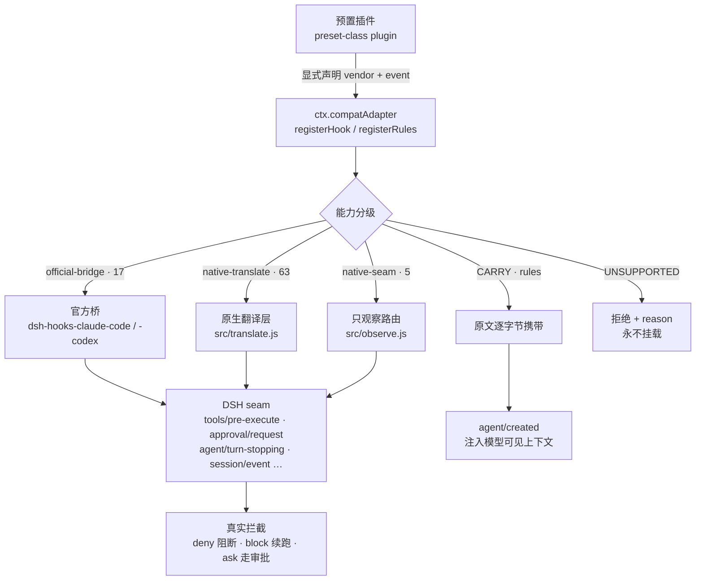

<div align="center">

<h1>dsh-compat-adapter</h1>

<p><b>让 Claude Code / Codex / WorkBuddy / OpenCode / Copilot 的 hooks 与 rules，在 DSH 里真正跑起来。</b></p>

<p>一个 DSH 前置适配插件：<b>显式声明 → 能力分级 → 路由到真实 seam</b>。<br/>不猜、不假装修好了、不把别家运行时塞进 Host。</p>

<p>
  <a href="README.en.md"><b>English</b></a> ·
  <b>简体中文</b>
</p>

<p>
  <a href="LICENSE"></a>
  <a href="#验证"></a>
  
  =24">
  
  
  
</p>

</div>

---

## 这是什么

DSH（DeepSeek Harness）是新的 agent 运行时。而你已经在 Claude Code、Codex、WorkBuddy、OpenCode、GitHub Copilot 里积累了成套的 hooks 与 rules —— 那些"写文件前先拦一下""工具调用后补一段上下文""会话结束时跑个脚本"的东西。

把它们搬到 DSH 最省事的做法，是照着名字硬接一遍。那会静默地坏掉：

> Claude 的 `updatedInput` 被解析了但不生效；
> Codex 的 `permissionDecision: "ask"` 没有审批路径，退化成放行；
> Copilot 把 deny 写在**顶层**，而 DSH 的 hook 解析器只读 `hookSpecificOutput` —— 直接复用的话，**每一个 deny 都会被当成"没有决定"而放行**；
> OpenCode 的插件是 TypeScript 回调，"名字"能对上，"回调体"根本过不来。

**这个插件存在的意义，是让每一次适配的"损失"都变成可读的输出，而不是一个看起来能跑的假象。**

它只做三件事：

| | |
|---|---|
| **声明** | 预置作者显式写出 vendor 与 event。从不嗅探文件名、从不猜归属。 |
| **分级** | 每个资产返回冻结的四级结果，损失逐条列出。 |
| **路由** | 有官方桥就复用官方桥，有可拦截 seam 就真翻译，只能观察就明说只能观察，做不到就拒绝。 |

### 两个不做

- **不重造官方桥。** 能映射的事件直接交给 `@deepseek-ai/dsh-hooks-claude-code` / `-codex`，本插件只负责"把声明变成桥的配置"和"没有桥的事件怎么办"。
- **不执行外部代码。** JS 函数 handler、OpenCode 的 TS 回调、Claude 的 `http` / `mcp_tool` / `prompt` / `agent` handler —— 一律 `UNSUPPORTED`。别家插件运行时不嵌进 DSH Host。

---

## 核心设计：分级，而不是布尔

每个注册都返回一个**冻结**的能力结果。没有 `supported: true` 这种把风险抹平的字段。

| 分级 | 含义 | 本版本情况 |
| :--- | :--- | :--- |
| `DIRECT` | DSH 存在 1:1 seam，语义原样保留。 | **零**。见下。 |
| `ADAPTED` | DSH 有 seam，但存在语义损失；`degradations[]` 逐条列明。 | **全部 85 个事件** |
| `CARRY` | 无通用映射，原文逐字节携带、会话开始注入；永不变成可执行策略。 | **全部 5 家 rules** |
| `UNSUPPORTED` | 无忠实映射；拒绝并给出 `reason`。 | 程序性边界（见下） |

### 为什么一个 `DIRECT` 都没有

两个官方桥本身就是"尽力而为"的方言适配。宣称逐字节忠实，就是虚假能力。

所以本插件**任何一行都不标 `DIRECT`** —— 全部 85 行都是 `ADAPTED`，每一行都必须写出自己的损失。这不是悲观，这是诚实：`test/matrix-readme.test.js` 会断言 `DIRECT.length === 0`，并断言每一行 `ADAPTED` 都至少带一条 `degradations`。

> **全覆盖不等于等价。** 85 个事件全部可执行（0 拒绝），但这是"每行都写明损失"的全覆盖，不是"全都一模一样"。

### 四条硬性不变量（测试强制，不是文档承诺）

| 不变量 | 由谁保证 |
| :--- | :--- |
| `ADAPTED` **必须**至少列出一条 `degradations`，否则构造即抛错 | `capabilityResult()` + `test/capability.test.js` |
| `UNSUPPORTED` **必须**带 `reason`，否则构造即抛错 | `capabilityResult()` + `test/capability.test.js` |
| 不认识的 vendor / event **抛错**（`UNKNOWN_VENDOR` / `UNKNOWN_EVENT`），不静默 fallback | `test/service.test.js` |
| `UNSUPPORTED` 的资产**永不挂载**：不写配置、不挂桥、不进 `status()` 的可执行列表 | `test/service.test.js` + `verify:live` |

那么在全部可执行的今天，`UNSUPPORTED` 还剩哪些真实触发路径？

- **JS 函数 handler** —— 不把外部代码执行进 Host。
- **缺 `ctx.shell`** —— 组合里没有 shell executor，命令 hook 跑不了；rules 仍然可用（只读文件、只注入）。
- **缺官方桥包** —— `dsh-hooks-*` 从 profile 解析不到时拒绝，不退回自研实现。
- **非 command handler** —— `http` / `mcp_tool` / `prompt` / `agent` 抛 `INVALID_HANDLER`。

---

## 支持的 vendor

五家互相独立。每家是一个纯数据模块（`src/vendors/<vendor>.js`）：无 I/O、不 import DSH，所以整张矩阵脱离 Harness 也能单测。

| Vendor | 别名 | 官方桥 | 事件 | 官方桥 | 原生翻译 | 只观察 | rules |
| :--- | :--- | :--- | ---: | ---: | ---: | ---: | :---: |
| `claude` | `claude-code`, `cc` | `dsh-hooks-claude-code` | 32 | 7 | 23 | 2 | CARRY |
| `codex` | `openai-codex` | `dsh-hooks-codex` | 12 | 5 | 4 | 3 | CARRY |
| `workbuddy` | `codebuddy` | `dsh-hooks-claude-code` | 24 | 5 | 19 | 0 | CARRY |
| `opencode` | — | **无** | 5 | 0 | 5 | 0 | CARRY |
| `copilot` | `github-copilot` | **无** | 12 | 0 | 12 | 0 | CARRY |
| **合计** | | | **85** | **17** | **63** | **5** | |

三个容易被误读的点：

- **`workbuddy`**：WorkBuddy 桌面端**没有公开 hook API**。本插件按 CodeBuddy 引擎（腾讯文档为 Claude-Code 兼容）处理，并把"桌面端无 API""`CODEBUDDY_PROJECT_DIR` 不导出""`modifiedInput` 不被读取"写进**每一条** `degradations`，由测试断言。
- **`opencode`**：5 个回调名全部映射到 DSH seam，但 **TS 回调"体"不携带** —— 必须改写为命令。这是 out of scope，不是"忘做了"。
- **`copilot`**：DSH 没有官方 Copilot 桥，所以这 12 个事件**全部由本插件自己翻译**。deny 真拦工具、block 真续跑、子 agent 真注入、approval 真决定 —— 详见 [Copilot 的特殊路径](#copilot-的特殊路径)。

---

## 工作流程



三种路由的差别，就是**"决定能不能到达 DSH"**：

| 路由 | 决定是否生效 | 用在哪 |
| :--- | :--- | :--- |
| `official-bridge` | ✅ 由官方桥映射 | 有官方桥的 vendor |
| `native-translate` | ✅ 本插件直接产出 DSH 裁决类型 | 无桥但 seam 可拦截 |
| `native-seam` | ❌ **只观察**，阻断尝试被记录并忽略 | 无取消能力的生命周期时刻 |

---

## 安装

标准 DSH Cordis bundle（`package.json` 的 `dsh.bundle.patch` + `cordis.patch.yml`）。

```bash
# 方式 A：plugin_manager 工具（受管理路径，推荐）
#   action: install_bundle, target: github:denceee/dsh-compat-adapter

# 方式 B：CLI
dsh plugin --profile <profile> add github:denceee/dsh-compat-adapter
```

装好后插件只做一件事：提供 `ctx.compatAdapter` 服务。**它自己不做任何适配** —— 适配由预置插件声明触发。

<details>
<summary><b>⚠️ 一个必须知道的坑：<code>cordis.patch.yml</code> 里的 <code>name</code> 必须是 bare specifier</b></summary>

bundle patch 的 `baseUrl` 是 **profile 根目录**，不是 patch 文件所在目录。所以 row 的 `name` 写成相对路径或 `node_modules/<pkg>/` 前缀都会找不到包。

```yaml
# ✅ 正确
- insert:
    - id: compat-adapter
      name: 'dsh-compat-adapter'
```

`test/index.test.js` 会断言这一点（并先剥掉注释，避免把注释里的反例误判成 patch 内容）。

</details>

### 预置类插件怎么用

在预置的 `plugins` 列表里插入本插件（装载顺序由 `inject` 保证），然后在你自己的 `apply()` 里调用服务：

```yaml
- insert:
    - id: preset-my-preset
      name: '@deepseek-ai/dsh-agent-preset'
      config:
        id: my-preset
        name: My Preset
        plugins:
          - id: compat-adapter
            name: 'dsh-compat-adapter'
          - id: my-vendor-assets
            name: './my-vendor-assets/index.js'
```

```js
// my-vendor-assets/index.js
export const name = 'my-vendor-assets'
export const inject = ['compatAdapter']

// apply 可以是 async：Cordis 会等待它，且注册必须在插件 setup 阶段完成。
export async function apply(ctx) {
  // ── hooks ──────────────────────────────────────────────────────────────
  const r = await ctx.compatAdapter.registerHook({
    vendor: 'claude',                        // 显式声明，不靠检测
    event: 'PreToolUse',
    matcher: 'Write',                        // 厂商 matcher 语义，原样交给官方桥
    handler: 'node ./hooks/no-write.mjs',    // 命令字符串 = command hook
  })
  // r.capability === 'ADAPTED'
  // r.seams      === ['tools/pre-execute']
  // r.degradations === [... 逐条损失 ...]

  // ── rules ──────────────────────────────────────────────────────────────
  const rules = await ctx.compatAdapter.registerRules({
    vendor: 'codex',
    source: 'rules/*.rules',            // 绝对路径 / 相对 baseDir / file:// / glob
    baseDir: '/abs/path/to/package',    // 相对路径的基准；必须绝对
  })
  // rules.capability === 'CARRY'，会话开始时作为上下文注入
}
```

---

## 公共 API

### `registerHook(declaration)`

| 字段 | 必填 | 说明 |
| :--- | :---: | :--- |
| `vendor` | ✅ | `claude` / `codex` / `workbuddy` / `opencode` / `copilot`，或文档化别名 |
| `event` | ✅ | 厂商事件名（如 `PreToolUse`）；未知事件抛 `UNKNOWN_EVENT` |
| `matcher` | — | 厂商 matcher 字符串；非字符串抛 `INVALID_MATCHER` |
| `handler` | — | 命令字符串，或 `{ type: 'command', command, timeoutSec? }`。`http` / `mcp_tool` / `prompt` / `agent` 抛 `INVALID_HANDLER`；JS 函数返回 `UNSUPPORTED` |
| `id` | — | 稳定 id，缺省 `<vendor>:<event>:<n>` |

返回 `Promise<CapabilityResult>`（冻结）。**可移植性不足不抛错** —— 只有"声明本身无法处理"才抛错。

### `registerRules(declaration)`

| 字段 | 必填 | 说明 |
| :--- | :---: | :--- |
| `vendor` | ✅ | 同上 |
| `source` | ✅ | 字符串或字符串数组：绝对路径、`baseDir` 相对路径、`file://` URL、glob |
| `baseDir` | — | 相对源的基准目录，必须绝对路径（否则抛 `INVALID_DECLARATION`） |
| `id` | — | 稳定 id，缺省 `<vendor>:rules:<n>` |

返回 `Promise<CapabilityResult>`，`capability === 'CARRY'`，`seams === ['agent/created']`。

**规则语义**：注册时**读盘并逐字节携带**（附 `sha256` 与 `bytes`），在 `agent/created`（fresh / resume / clear / compact 全覆盖）时通过 `agent.inject(createUserMessage(...))` 作为模型可见上下文入队。注入消息的 `source.kind` 是 `compat-adapter-rules`，与 DSH 自带的 `agent-instructions` 区分，日志里可追溯。

> **规则永远不是安全边界。** 全部 `CARRY`。尤其 Codex 的 Starlark 规则是命令策略 DSL，DSH 没有对应规则引擎 —— 本插件只把它作为"原工具策略的说明文本"注入，**不翻译、不强制执行**。任何"规则会阻止某事"的预期都是错的；要强制，请写原生 DSH 插件挂到 `tools/pre-execute`。

### 其他方法

| 方法 | 作用 |
| :--- | :--- |
| `matrix()` | 静态能力矩阵（本版本"永远能做什么"）。 |
| `status()` | 运行时审计（"此刻实际在跑什么"）：每个 hook 的分级 / seam / 是否挂了桥，规则文件的路径 / 字节 / sha256，以及当前组合里 `shell` / `sessionProjections` 是否存在。 |
| `dispose()` | 卸载所有桥与监听；之后注册抛 `ADAPTER_DISPOSED`（不会半死不活地继续）。 |

### 配置项（`cordis.patch.yml` 的 row `config`）

| 字段 | 默认 | 说明 |
| :--- | :--- | :--- |
| `logRegistrations` | `true` | 每次分级注册输出一行结构化日志 |
| `failClosed` | `true` | 缺所需 seam 时拒绝注册，而不是挂一个空转的 no-op |
| `targetDshVersion` | `0.2.0-rc.2` | 目标 DSH 版本；不一致时按 `failClosed` 报错或告警 |
| `maxRuleBytes` | `524288` | 单文件携带上限；超限**报错**而不是静默截断 |

---

## 阻断契约

参考工具文档里"exit code 2 = 阻断"的行为，在本 DSH 版本的两个官方桥里**不可靠**（可能被记录为 `decision: 'pass'` 而放行）。因此本插件统一契约：

> **stdout 输出 `hookSpecificOutput.permissionDecision`（`deny` / `ask`）+ 退出码 `0`。**

```bash
#!/usr/bin/env bash
# 例：拒绝写入 —— deny + exit 0
printf '%s' '{"hookSpecificOutput":{"hookEventName":"PreToolUse","permissionDecision":"deny","permissionDecisionReason":"no writes in this preset"}}'
exit 0
```

本插件生成的任何示例、测试与文档都用这一种；**从不生成依赖 exit 2 的 handler**。`src/vendors/shared.js` 的 `permissionDecisionOutput()` 是唯一生成入口，测试直接断言生成物含 `permissionDecision`、且**不含**遗留的顶层 `decision` 字段。

`ask` 映射成 DSH 的 `{kind:'ask'}`，`deny` 映射成 `{kind:'deny'}`（经官方桥，不经过本插件）。**exit 2 仍会被桥解析**（用户手写的老 hook 不会被吞掉），但这不是本插件承诺的契约路径。

---

## Copilot 的特殊路径

GitHub Copilot 是**唯一没有官方 DSH 桥**的 vendor（Claude / Codex / WorkBuddy 都能复用官方桥），所以它的适配路径不同：**本插件真的实现翻译层**，不是旁观。

### 为什么不能直接复用 hook protocol

DSH 的 `@deepseek-ai/dsh-hook-protocol` 只认 **Claude/Codex 方言**：

```js
// DSH 解析器只读这一层
{ "hookSpecificOutput": { "permissionDecision": "deny", "permissionDecisionReason": "…" } }
```

而 Copilot 把决定写在**顶层**：

```json
{ "permissionDecision": "deny", "permissionDecisionReason": "…" }
```

若直接复用，**每一个 Copilot deny 都会被静默当成"没有决定"而放行**。所以 `src/translate.js` 里有一层 `parseCopilotStdout()` / `normalizeCopilotOutput()`：先按 Copilot 原生格式解析，再归一化成内部形状。

这条路径有专门的测试（`test/smoke-copilot.test.js`，17 个用例）并纳入 `npm run verify:live` 的真实启动验证。

### 事件映射

| Copilot 事件 | DSH seam | 能否阻断 |
| :--- | :--- | :--- |
| `preToolUse` | `tools/pre-execute` | ✅ deny / ask 真的生效 |
| `postToolUse` | `tools/post-execute` | 转发 `additionalContext`（`modifiedResult` 不采纳） |
| `subagentStart` | `subagent/start` | ✅ 可把上下文注入**子 agent**（经 `ctx.agents.get(runId)`） |
| `subagentStop` | `subagent/end` | 只观察（拿到 `stopReason` / `lastAssistantMessage`） |
| `errorOccurred` | `agent/error` | 只观察（DSH 错误路径无裁决通道） |
| `sessionStart` | `agent/created` | 注入 `additionalContext` 为消息 |
| `sessionEnd` | `agent/disposed` | 只观察 |
| `userPromptSubmitted` | `agent/pre-step` | 注入上下文（不改写 prompt） |
| `agentStop` | `agent/turn-stopping` | ✅ `decision:"block"` **真的强制续跑**（含 8 次 runaway guard） |
| `notification` | `agent/status` | 只观察（DSH 只发布状态翻转，无 notification 类型） |
| `permissionRequest` | `approval/request` | ✅ allow → `allowed-once`，deny → `rejected` |
| `postToolUseFailure` | `tools/post-execute` | 仅当结果被标记为 error 时触发 |

### 三处必须注意的方言差异

1. **matcher 是锚定正则。** Copilot 编译为 `^(?:PATTERN)$` 且必须全匹配 —— `bas` **不会**匹配 `bash`；无效正则会让该 hook **整体跳过**（不是 match-all）。本插件按此实现。
2. **`allow` 不预批准。** Copilot 的 `allow` 是"不弹权限提示"，不是"强制放行"，所以翻译成 `next()` 而非 allow 短路。
3. **阻断契约仍统一为 stdout + exit 0。** Copilot 本身还接受 exit 2 表示 deny，但本插件不让 hook 依赖它 —— 同一个 hook 脚本在各 vendor 下行为一致。

---

## 支持矩阵

> 本节**由代码生成**：`npm run matrix:write` 从 `src/matrix.js` 重新生成，`test/matrix-readme.test.js` 在漂移时报错。**不要手改。**

读矩阵需要注意的三件事：

1. **`ADAPTED` 的损失是逐条列出的**，不是修辞。例如 Claude `PreToolUse` 的 `updatedInput` 只被解析、不被采纳；Codex `PreToolUse` 的 `ask` 没有审批路径；Claude `SubagentStart` 的 `agent_type` 恒为 `general-purpose`（针对具体 agent type 的 matcher 永不命中）。
2. **`native-seam` 的事件是"只观察"**：`PreCompact` 映射到 `session/event` 的 `compaction/start`，`SessionEnd` 映射到 `agent/disposed`。DSH 的压缩是服务调用、不是可取消 waterfall，所以**不能否决压缩**；尝试阻断只会被记入审计日志并忽略。
3. **WorkBuddy 的每一行都必须说明"桌面端无公开 hook API"** —— 这是最容易误读的地方，所以它被写进每条 `degradations` 并由测试断言。

<details>
<summary><b>展开完整矩阵（85 行，含每行损失说明）</b></summary>

<!-- MATRIX:START -->

### Hooks: vendor event → DSH seam

| Vendor | Event | Capability | Route | DSH seam(s) | Losses / reason |
| --- | --- | --- | --- | --- | --- |
| claude | `SessionStart` | ADAPTED | official bridge (claude) | agent/created | Runs detached through the bridge, so context can miss the model first request.; Plain-stdout context, initialUserMessage, sessionTitle, watchPaths and CLAUDE_ENV_FILE are not consumed.; Payload omits model, agent_type and session_title. |
| claude | `UserPromptSubmit` | ADAPTED | official bridge (claude) | agent/pre-step | Deny is honored; plain-stdout context, sessionTitle and suppressOriginalPrompt are not.; Unless the hook sets its own timeout the bridge uses its 600s default, not the reference 30s. |
| claude | `PreToolUse` | ADAPTED | official bridge (claude) | tools/pre-execute | deny and ask are honored; allow does not pre-approve and defer is unsupported.; updatedInput is parsed and warned about but not honored.; additionalContext from a PreToolUse hook is ignored. |
| claude | `PostToolUse` | ADAPTED | official bridge (claude) | tools/post-execute | Blocking feedback and additionalContext work; updatedToolOutput and updatedMCPToolOutput do not.; tool_response is flattened to text. |
| claude | `Stop` | ADAPTED | official bridge (claude) | agent/turn-stopping | A blocking Stop forces another step, but stop_hook_active is always false and last_assistant_message is omitted.; There is no consecutive-block cap; an unconditional blocking hook keeps forcing turns. |
| claude | `SubagentStart` | ADAPTED | official bridge (claude) | subagent/start | agent_type is the constant general-purpose; a matcher naming a specific agent type never fires.; Injected context can only reach an in-process child. |
| claude | `SubagentStop` | ADAPTED | official bridge (claude) | subagent/end | Observe-only: cannot block the child or feed it context.; agent_transcript_path, last_assistant_message, background_tasks and session_crons are omitted. |
| claude | `PreCompact` | ADAPTED | native seam, observe-only (`compaction/start`) | session/event | Cannot veto compaction: DSH compaction is a service call, not a cancellable waterfall, so the hook is observe-only.; Fires on the durable compaction/start event after compaction was requested, not before the summary is computed.; A blocking decision (deny / exit 2) is audited but does NOT prevent compaction. |
| claude | `SessionEnd` | ADAPTED | native seam, observe-only (`agent/disposed`) | agent/disposed | agent/disposed fires when an Agent leaves the live registry, which is broader than the reference end-of-session moment (dispose also happens on reload/teardown).; Payload carries no reason and no transcript path; anything the hook needs must be read from the session working directory. |
| claude | `Setup` | ADAPTED | native translation (`session/created`) | session/created | Observe-only: DSH announces a created session but exposes no pre-activation configuration channel here.; Fires when a Session object is created, which is after the harness is already running — not before hooks are enabled as the reference tool does. |
| claude | `InstructionsLoaded` | ADAPTED | native translation (`session/created`) | session/created | Observe-only and coarser: DSH announces the session, not which instruction files were loaded; `instructionFiles` is null.; Fires once per created session rather than once per discovered instruction file. |
| claude | `UserPromptExpansion` | ADAPTED | native translation (`agent/pre-step`) | agent/pre-step | Observe-only: DSH pre-step receives the already-assembled batch, so the hook cannot rewrite the expansion.; Fires per step, not once per expanded prompt. |
| claude | `MessageDisplay` | ADAPTED | native translation (`session/event`) | session/event | Observe-only and approximate: DSH has no display seam, so this reports the durable message event that would be displayed.; The hook cannot alter, delay, or suppress presentation. |
| claude | `PermissionRequest` | ADAPTED | native translation (`approval/request`) | approval/request | Decisions map onto DSH ApprovalOutcome: allow→`allowed-once`, deny→`rejected`. DSH has no broader grant, so a hook cannot express "always allow".; The approval waterfall only runs when DSH actually asks for approval; a tool the preset already permits never reaches this hook.; The reference payload’s permission-mode detail is absent; DSH reports the tool and its reason only. |
| claude | `PermissionDenied` | ADAPTED | native translation (`session/event`) | session/event | Observe-only: the decision already committed, so the hook cannot change it.; Driven by the durable `approval/decided` audit event with outcome `rejected`; other outcomes do not fire it. |
| claude | `PostToolUseFailure` | ADAPTED | native translation (`tools/post-execute`) | tools/post-execute | Mounted by this adapter rather than the shipped bridge (the bridge does not map this event).; Only fires when the result is marked as an error; DSH uses one waterfall for successes and failures. |
| claude | `PostToolBatch` | ADAPTED | native translation (`tools/post-execute`) | tools/post-execute | Approximate: DSH dispatches tools individually and has no batch seam, so this fires per completed tool call rather than once per batch.; The hook receives one tool result, not a batch summary. |
| claude | `Notification` | ADAPTED | native translation (`agent/status`) | agent/status | Observe-only and coarse: DSH publishes agent status flips, not typed notifications.; `matcher` cannot narrow because DSH carries no notification type. |
| claude | `TaskCreated` | ADAPTED | native translation (`todo/write`) | session/event | Observe-only: DSH publishes a whole todo-list snapshot, so creation is derived by diffing snapshots.; Only todo-style tasks are visible; jobs and team tasks register through services with no event. |
| claude | `TaskCompleted` | ADAPTED | native translation (`todo/write`) | session/event | Observe-only: completion is derived from a todo snapshot where an item's status became `completed`.; A task removed from the list without being completed does not fire it. |
| claude | `StopFailure` | ADAPTED | native translation (`agent/error`) | agent/error | Observe-only: DSH exposes no verdict channel on its error path, so this hook can report but never retry or alter the failure.; Fires for any turn/step agent error, not only the "API error ended the turn" moment the reference tool reports.; Reference payload fields (error type, retryability) are approximated from the thrown error and are not normalized to Claude’s vocabulary. |
| claude | `TeammateIdle` | ADAPTED | native translation (`agent/status`) | agent/status | Observe-only: DSH status flips are a consequence of driver activity, so a hook cannot make an agent idle.; Fires for any agent entering `idle`, not only teammates in a team. |
| claude | `ConfigChange` | ADAPTED | native translation (`settings/document-updated`) | settings/document-updated | Observe-only: the new settings revision has already committed, so a hook cannot block or rewrite it.; DSH reports settings namespaces, not the configuration FILES the reference tool watches; `filePath` is null and a matcher on a path never narrows. |
| claude | `CwdChanged` | ADAPTED | native translation (`session/created`) | session/created | Observational approximation: DSH pins the session working directory at creation and never changes it, so this fires once at session creation with the initial cwd instead of on a change. |
| claude | `DirectoryAdded` | ADAPTED | native translation (`session/created`) | session/created | Observational approximation: DSH grants one working directory per session and has no directory-addition event, so this fires once at session creation. |
| claude | `FileChanged` | ADAPTED | native translation (`tools/post-execute`) | tools/post-execute | Approximate: DSH has no file-watch hook contract, so this fires after a tool call that could have changed files, not when a file actually changes.; External edits (outside DSH tool calls) do not fire it. |
| claude | `WorktreeCreate` | ADAPTED | native translation (`session/created`) | session/created | Approximate: DSH has no worktree lifecycle, so this fires at session creation — the moment an isolated worktree would be prepared — without any worktree information in the payload. |
| claude | `WorktreeRemove` | ADAPTED | native translation (`agent/disposed`) | agent/disposed | Approximate: DSH has no worktree lifecycle, so this fires when the agent leaves the registry — the moment a worktree would be cleaned up.; The payload carries no worktree path. |
| claude | `PreModelSwitch` | ADAPTED | native translation (`session/created`) | session/created | Approximate: DSH has no pre-switch waterfall, so this cannot run before a switch; it fires at session creation when the initial model is bound.; It does not observe later model changes. |
| claude | `PostModelSwitch` | ADAPTED | native translation (`session/event`) | session/event | Approximate: DSH publishes model binding through the durable `request/header` event, so this fires on header changes rather than on a dedicated switch event. |
| claude | `Elicitation` | ADAPTED | native translation (`agent/status`) | agent/status | Approximate and observe-only: DSH has no MCP elicitation seam, so this reports agent status flips while a question is pending rather than the elicitation itself.; The hook cannot answer or block it. |
| claude | `ElicitationResult` | ADAPTED | native translation (`agent/status`) | agent/status | Approximate and observe-only: no DSH event carries an elicitation result, so this reports the status flip that follows the answer. |
| codex | `SessionStart` | ADAPTED | official bridge (codex) | agent/created | Runs detached, so context can miss the first request.; Payload `transcript_path` is always null and no hook environment is injected. |
| codex | `UserPromptSubmit` | ADAPTED | official bridge (codex) | agent/pre-step | Deny is honored; plain stdout is promoted to additionalContext only for this event and SessionStart.; Payload omits fields the reference provides that DSH cannot reconstruct (for example prompt ids). |
| codex | `PreToolUse` | ADAPTED | official bridge (codex) | tools/pre-execute | Only blocking decisions are honored: Codex `permissionDecision: "ask"` has no approval path and is not surfaced as an ask.; `updatedInput` rewrites are not honored.; tool_input is flattened to `{ command }` (or `{}`), so non-shell tool arguments are not faithfully exposed. |
| codex | `PostToolUse` | ADAPTED | official bridge (codex) | tools/post-execute | Blocking feedback and additionalContext work; output rewriting does not.; `tool_response` is flattened to text. |
| codex | `Stop` | ADAPTED | official bridge (codex) | agent/turn-stopping | A blocking Stop forces another step; stop_hook_active is always false and last_assistant_message is null.; No consecutive-block cap exists. |
| codex | `PermissionRequest` | ADAPTED | native translation (`approval/request`) | approval/request | Not routed through the Codex bridge (it does not implement this event); this adapter mounts the approval waterfall itself.; Decisions map onto DSH ApprovalOutcome: allow→`allowed-once`, deny→`rejected`; DSH has no "always allow".; DSH raises the waterfall only when an approval is actually requested. |
| codex | `PreCompact` | ADAPTED | native seam, observe-only (`compaction/start`) | session/event | Observe-only: cannot veto compaction (DSH compaction is a service call, not a cancellable waterfall).; Fires on the durable compaction/start event. |
| codex | `PostCompact` | ADAPTED | native seam, observe-only (`compaction/end`) | session/event | Fires on the durable compaction/end event; a failed compaction also ends the transaction and is reported as an error field.; No payload parity with the reference event. |
| codex | `SessionEnd` | ADAPTED | native seam, observe-only (`agent/disposed`) | agent/disposed | agent/disposed is broader than the reference session end (reload and teardown also dispose Agents).; No reason or transcript path in the payload. |
| codex | `SubagentStart` | ADAPTED | native translation (`subagent/start`) | subagent/start | Not routed through the Codex bridge (it does not implement this event); this adapter mounts the observation itself.; Observe-only: DSH has no Codex-shaped context-injection channel at this seam for a bridge-less wiring, so a hook can log but its context is not injected.; Codex payload fields describing the subagent kind are absent; DSH carries only provider/local identity. |
| codex | `SubagentStop` | ADAPTED | native translation (`subagent/end`) | subagent/end | Not routed through the Codex bridge (it does not implement this event); this adapter mounts the observation itself.; Observe-only: the child has already settled, so neither blocking nor response rewriting can reach it. |
| codex | `Interrupt` | ADAPTED | native translation (`agent/status`) | agent/status | Observe-only and approximate: DSH publishes status flips, not an interrupt event; this fires when an agent returns to `idle`, which an interrupt causes but does not identify.; The hook cannot cancel or delay the interruption. |
| workbuddy | `SessionStart` | ADAPTED | official bridge (claude) | agent/created | WorkBuddy desktop has no public hook API; this declaration is interpreted as a CodeBuddy-engine hook config, which Tencent documents as Claude-Code-compatible.; CODEBUDDY_PROJECT_DIR is not exported; command substitution and hook environment only receive CLAUDE_PROJECT_DIR.; CodeBuddy `modifiedInput` is not read (the Claude bridge only parses `updatedInput`, which is itself not honored by DSH).; Runs detached; context can miss the first request. |
| workbuddy | `UserPromptSubmit` | ADAPTED | official bridge (claude) | agent/pre-step | WorkBuddy desktop has no public hook API; this declaration is interpreted as a CodeBuddy-engine hook config, which Tencent documents as Claude-Code-compatible.; CODEBUDDY_PROJECT_DIR is not exported; command substitution and hook environment only receive CLAUDE_PROJECT_DIR.; CodeBuddy `modifiedInput` is not read (the Claude bridge only parses `updatedInput`, which is itself not honored by DSH).; Deny is honored; plain-stdout context is not promoted. |
| workbuddy | `PreToolUse` | ADAPTED | official bridge (claude) | tools/pre-execute | WorkBuddy desktop has no public hook API; this declaration is interpreted as a CodeBuddy-engine hook config, which Tencent documents as Claude-Code-compatible.; CODEBUDDY_PROJECT_DIR is not exported; command substitution and hook environment only receive CLAUDE_PROJECT_DIR.; CodeBuddy `modifiedInput` is not read (the Claude bridge only parses `updatedInput`, which is itself not honored by DSH).; Matcher semantics differ: CodeBuddy matches a case-sensitive regex against the tool name, while the Claude bridge uses its literal-or-regex rule, so a pattern like `edit` may match fewer tools than in WorkBuddy.; Only deny/ask decisions are honored; modifiedInput is not. |
| workbuddy | `PostToolUse` | ADAPTED | official bridge (claude) | tools/post-execute | WorkBuddy desktop has no public hook API; this declaration is interpreted as a CodeBuddy-engine hook config, which Tencent documents as Claude-Code-compatible.; CODEBUDDY_PROJECT_DIR is not exported; command substitution and hook environment only receive CLAUDE_PROJECT_DIR.; CodeBuddy `modifiedInput` is not read (the Claude bridge only parses `updatedInput`, which is itself not honored by DSH).; Output rewriting is not honored; tool_response is flattened to text. |
| workbuddy | `Stop` | ADAPTED | official bridge (claude) | agent/turn-stopping | WorkBuddy desktop has no public hook API; this declaration is interpreted as a CodeBuddy-engine hook config, which Tencent documents as Claude-Code-compatible.; CODEBUDDY_PROJECT_DIR is not exported; command substitution and hook environment only receive CLAUDE_PROJECT_DIR.; CodeBuddy `modifiedInput` is not read (the Claude bridge only parses `updatedInput`, which is itself not honored by DSH).; No consecutive-block cap; stop_hook_active is always false. |
| workbuddy | `SessionEnd` | ADAPTED | native translation (`agent/disposed`) | agent/disposed | Runs through this adapter’s own native mapping, not the Claude bridge (the bridge does not implement SessionEnd).; DSH agent/disposed fires whenever an Agent leaves the registry (reload, teardown), broader than a session end.; Observe-only: no decision output is honored. |
| workbuddy | `PreCompact` | ADAPTED | native translation (`compaction/start`) | session/event | Runs through this adapter’s own native mapping, not the Claude bridge.; Observe-only: DSH compaction is a service call, not a cancellable waterfall, so the hook cannot veto compaction. |
| workbuddy | `PostToolUseFailure` | ADAPTED | native translation (`tools/post-execute`) | tools/post-execute | Documented by CodeBuddy CLI only and not bridged; this adapter mounts the observation itself.; DSH reports successes and failures through one waterfall, so this fires only when the result is marked as an error. |
| workbuddy | `SubagentStart` | ADAPTED | native translation (`subagent/start`) | subagent/start | Documented by CodeBuddy CLI only and not bridged; this adapter mounts its own observation.; The agent-type label is absent from DSH’s seam, so a matcher on agent type cannot narrow. |
| workbuddy | `SubagentStop` | ADAPTED | native translation (`subagent/end`) | subagent/end | Documented by CodeBuddy CLI only and not bridged; this adapter mounts its own observation.; Observe-only: the child has already settled. |
| workbuddy | `StopFailure` | ADAPTED | native translation (`agent/error`) | agent/error | Documented by CodeBuddy CLI only; this adapter mounts its own observation on DSH agent errors.; Observe-only: DSH exposes no verdict channel on its error path. |
| workbuddy | `PermissionDenied` | ADAPTED | native translation (`session/event`) | session/event | Observe-only: driven by the durable `approval/decided` audit event after the decision committed.; Only `rejected` outcomes fire it. |
| workbuddy | `TaskCreated` | ADAPTED | native translation (`todo/write`) | session/event | Observe-only: derived by diffing whole todo-list snapshots, not from a create event.; Only todo-style tasks are visible. |
| workbuddy | `TaskCompleted` | ADAPTED | native translation (`todo/write`) | session/event | Observe-only: derived when a todo item's status becomes `completed` in a snapshot.; A task removed without completing does not fire it. |
| workbuddy | `TeammateIdle` | ADAPTED | native translation (`agent/status`) | agent/status | Observe-only: fires for any agent entering `idle`, not only team members. |
| workbuddy | `FileChanged` | ADAPTED | native translation (`tools/post-execute`) | tools/post-execute | Approximate: fires after a tool call that could have changed files, not when a file actually changes.; External edits do not fire it. |
| workbuddy | `CwdChanged` | ADAPTED | native translation (`session/created`) | session/created | Observational approximation: DSH pins the session cwd at creation and never changes it, so this fires once with the initial cwd. |
| workbuddy | `WorktreeCreate` | ADAPTED | native translation (`session/created`) | session/created | Approximate: DSH has no worktree lifecycle, so this fires at session creation without worktree details. |
| workbuddy | `WorktreeRemove` | ADAPTED | native translation (`agent/disposed`) | agent/disposed | Approximate: fires when the agent leaves the registry; the payload carries no worktree path. |
| workbuddy | `Setup` | ADAPTED | native translation (`session/created`) | session/created | Observe-only: DSH announces session creation after the harness is running. |
| workbuddy | `InstructionsLoaded` | ADAPTED | native translation (`session/created`) | session/created | Observe-only and coarser: reports session creation, not which files loaded (`instructionFiles` is null). |
| workbuddy | `ConfigChange` | ADAPTED | native translation (`settings/document-updated`) | settings/document-updated | Documented by CodeBuddy CLI only; this adapter mounts its own observation on DSH settings updates.; Observe-only and namespace-scoped: no file path is reported, so a matcher on a config path never narrows. |
| workbuddy | `Elicitation` | ADAPTED | native translation (`agent/status`) | agent/status | Observe-only and approximate: DSH has no MCP elicitation seam, so this reports agent status flips rather than an elicitation request.; The hook cannot answer or block the elicitation. |
| workbuddy | `ElicitationResult` | ADAPTED | native translation (`agent/status`) | agent/status | Observe-only and approximate: no DSH event carries an elicitation result; this reports the following status flip. |
| opencode | `tool.execute.before` | ADAPTED | native translation (`tools/pre-execute`) | tools/pre-execute | OpenCode blocks by THROWING inside an in-process callback; there is no stdout/exit contract. This adapter runs the author’s command instead, so the hook body must be re-authored as a command rather than carried verbatim.; A deny maps onto DSH tools/pre-execute; OpenCode has no `ask` equivalent here, so a command that wants confirmation must say so in its reason.; The callback’s in-process SDK arguments (client, $, project) are not available to a command hook. |
| opencode | `tool.execute.after` | ADAPTED | native translation (`tools/post-execute`) | tools/post-execute | The in-process callback body is not carried; the hook must be a command that reads the tool result from stdin.; Only `additionalContext` is forwarded back; OpenCode callbacks could mutate native result objects directly. |
| opencode | `event` | ADAPTED | native translation (`session/event`) | session/event | OpenCode’s event bus has no serializable contract; this maps the DURABLE session event stream instead, so only events DSH logs are observable.; The callback body is not carried: the hook is a command invoked per logged event. |
| opencode | `shell.env` | ADAPTED | native translation (`shell/env`) | shellEnv | DSH’s shell environment registry only exposes variables under the `DSH_` prefix, so an OpenCode hook that sets arbitrary environment variables can only contribute `DSH_*` ones.; The registry is rebuilt per model shell call, not per OpenCode shell invocation.; The callback body is not carried: the hook is a command whose stdout becomes the variable values. |
| opencode | `permission` | ADAPTED | native translation (`approval/request`) | approval/request | OpenCode’s `permission` config is a policy table, not a hook; this maps a COMMAND declaration onto the approval waterfall, so the policy must be expressed as a script.; Decisions map onto DSH ApprovalOutcome: allow→`allowed-once`, deny→`rejected`; there is no "always" grant. |
| copilot | `preToolUse` | ADAPTED | native translation (`tools/pre-execute`) | tools/pre-execute | Translated directly by this adapter: DSH ships no Copilot bridge, so payloads, matcher anchoring and decision mapping are re-implemented here rather than reused.; Matcher is a regular expression anchored as `^(?:PATTERN)$` by Copilot; this adapter passes the pattern through DSH matcher handling, so an unanchored pattern matches more here than it would in Copilot.; `modifiedArgs` (argument rewriting) is NOT honored; only allow/deny/ask are.; Copilot tool names are lowercase (`bash`, `edit`, `create`, `view`, `grep`, `glob`, `web_fetch`, `task`, `ask_user`) and do not match DSH tool names one-to-one, so a matcher written for Copilot may select different tools.; Copilot denies the tool on exit 2 and on ANY non-zero exit (fail-closed); this adapter honors deny only through stdout `permissionDecision`, so a hook that signals denial only by exit code will not block here. |
| copilot | `postToolUse` | ADAPTED | native translation (`tools/post-execute`) | tools/post-execute | Translated directly by this adapter: DSH ships no Copilot bridge, so payloads, matcher anchoring and decision mapping are re-implemented here rather than reused.; `modifiedResult` (result rewriting) is NOT honored; only `additionalContext` is forwarded.; Matcher regex is applied to tool names that differ from Copilot’s tool vocabulary. |
| copilot | `postToolUseFailure` | ADAPTED | native translation (`tools/post-execute`) | tools/post-execute | Translated directly by this adapter: DSH ships no Copilot bridge, so payloads, matcher anchoring and decision mapping are re-implemented here rather than reused.; DSH reports successes and failures through one waterfall, so this hook fires only when the result is marked as an error.; The reference event can inject retry guidance; DSH forwards `additionalContext` on the same path as a successful call. |
| copilot | `sessionStart` | ADAPTED | native translation (`agent/created`) | agent/created | Translated directly by this adapter: DSH ships no Copilot bridge, so payloads, matcher anchoring and decision mapping are re-implemented here rather than reused.; Runs synchronously during agent creation, so it can delay the first turn; Copilot runs session hooks before the session is interactive.; Copilot’s `additionalContext` is injected as a sourced user message; other sessionStart outputs are not consumed.; Copilot prompt-type hooks (`type: "prompt"`) are not supported by this adapter (command hooks only). |
| copilot | `sessionEnd` | ADAPTED | native translation (`agent/disposed`) | agent/disposed | Translated directly by this adapter: DSH ships no Copilot bridge, so payloads, matcher anchoring and decision mapping are re-implemented here rather than reused.; DSH `agent/disposed` fires whenever an Agent leaves the live registry (including reload and teardown), which is broader than Copilot’s end-of-session moment.; Observe-only: Copilot sessionEnd has no decision output, and neither does this mapping. |
| copilot | `userPromptSubmitted` | ADAPTED | native translation (`agent/pre-step`) | agent/pre-step | Translated directly by this adapter: DSH ships no Copilot bridge, so payloads, matcher anchoring and decision mapping are re-implemented here rather than reused.; DSH pre-step receives the already-assembled message batch; the hook cannot rewrite the prompt, only contribute context.; Copilot can block the prompt from this hook; this adapter does not translate that into a DSH rejection. |
| copilot | `agentStop` | ADAPTED | native translation (`agent/turn-stopping`) | agent/turn-stopping | Translated directly by this adapter: DSH ships no Copilot bridge, so payloads, matcher anchoring and decision mapping are re-implemented here rather than reused.; `decision:"block"` is honored by appending a next-step message during the serial `agent/turn-stopping` dispatch, which the agent loop re-checks before ending the turn. The 8-block runaway guard is reproduced, so behavior matches Copilot.; `stop_hook_active` is always false: DSH does not expose whether this turn was already forced to continue, so a hook that self-limits on that flag cannot do so here.; The forced turn is driven by a synthetic user message carrying the hook reason; Copilot instead reuses its own continuation path, so message provenance differs. |
| copilot | `subagentStart` | ADAPTED | native translation (`subagent/start`) | subagent/start | Translated directly by this adapter: DSH ships no Copilot bridge, so payloads, matcher anchoring and decision mapping are re-implemented here rather than reused.; Context is injected by resolving the child through ctx.agents.get(runId) during the start notification; a provider whose child Agent is not yet visible (e.g. a remote provider) receives no context.; `matcher` on agent name is NOT supported: DSH carries no agent-name label on this seam, so the field is absent from the payload and a matcher that filters by name never narrows anything. |
| copilot | `subagentStop` | ADAPTED | native translation (`subagent/end`) | subagent/end | Translated directly by this adapter: DSH ships no Copilot bridge, so payloads, matcher anchoring and decision mapping are re-implemented here rather than reused.; Observe-only: the child has already settled, so `decision:"block"` cannot continue it and `modifiedResponse` cannot rewrite its result.; `matcher` on agent name is NOT supported (no agent-name label on this seam). |
| copilot | `errorOccurred` | ADAPTED | native translation (`agent/error`) | agent/error | Translated directly by this adapter: DSH ships no Copilot bridge, so payloads, matcher anchoring and decision mapping are re-implemented here rather than reused.; Observe-only: DSH exposes no verdict channel on its error path, so a hook cannot recover, retry, or alter the failure.; Only turn/step-scoped agent errors are observed; provider transport failures reach `agent/request-error` instead and service-level errors are not events at all.; `errorContext` is reported as "system" unless the failure is known to be model- or tool-related, because DSH does not classify errors the way Copilot does. |
| copilot | `notification` | ADAPTED | native translation (`agent/status`) | agent/status | Translated directly by this adapter: DSH ships no Copilot bridge, so payloads, matcher anchoring and decision mapping are re-implemented here rather than reused.; Observe-only and coarse: DSH publishes agent status flips, not the typed notification kinds Copilot defines.; `matcher` on notification_type cannot narrow because DSH carries no notification type. |
| copilot | `permissionRequest` | ADAPTED | native translation (`approval/request`) | approval/request | Translated directly by this adapter: DSH ships no Copilot bridge, so payloads, matcher anchoring and decision mapping are re-implemented here rather than reused.; Decisions map onto DSH ApprovalOutcome: allow→`allowed-once`, deny→`rejected`; DSH has no "always allow" grant.; DSH raises this waterfall only when an approval is actually requested; pre-approved tools never reach the hook.; `interrupt: true` (stop the agent on deny) has no DSH equivalent and is ignored. |

### Rules: carried and injected, never executed

| Vendor | Capability | Accepted formats | Default on-disk sources |
| --- | --- | --- | --- |
| claude | CARRY | markdown, claude-rules-frontmatter | Carried verbatim and injected as a sourced user message at session start. Claude treats rules as context, not enforced configuration; this adapter preserves that precisely and never turns them into tool policy. |
| codex | CARRY | starlark | Carried verbatim and injected as a sourced user message at session start. Codex rules are a Starlark command-execution policy (allow / prompt / forbidden) for what may run outside the sandbox; DSH has no equivalent rule engine, so this adapter does NOT translate or enforce them. Treat the injected text as documentation for the model, never as a security boundary. |
| workbuddy | CARRY | markdown | Carried verbatim and injected as a sourced user message at session start. WorkBuddy desktop project instructions entered in the UI are cloud-side and cannot be carried; only on-disk CodeBuddy rules files are read. |
| opencode | CARRY | markdown | Carried verbatim and injected as a sourced user message at session start. Remote URLs in the OpenCode `instructions` array are NOT fetched: this adapter does not make network requests, so a remote instruction source must be materialized to a local file first. |
| copilot | CARRY | markdown, copilot-instructions-frontmatter | Carried verbatim and injected as a sourced user message at session start. Copilot treats these files as instructions/context, not enforced configuration; this adapter preserves that and never turns them into tool policy. `applyTo` frontmatter is carried as text and is NOT interpreted as path scoping. |

### Vendor plugin runtimes: out of scope

| Vendor | Capability | Reason |
| --- | --- | --- |
| claude | UNSUPPORTED | Claude Code plugin runtimes (plugin hooks that are JS modules, MCP-provided tools) are not command hooks; only the JSON command-hook config is adapted. |
| codex | UNSUPPORTED | Codex has no TypeScript plugin runtime in scope; only its command hooks.json and rules files are adapted. |
| workbuddy | UNSUPPORTED | WorkBuddy/CodeBuddy plugin runtimes (IDE extensions, MCP servers, workflow scripts) are out of scope: this adapter adapts JSON hooks + rules text only. |
| opencode | UNSUPPORTED | OpenCode plugins ARE TypeScript callbacks in a co-resident runtime (tool.execute.before/after, event, shell.env). Porting them means embedding a foreign plugin runtime in the DSH Host — explicitly out of scope; only OpenCode AGENTS.md/instructions text is carried. |
| copilot | UNSUPPORTED | Copilot’s SDK hook API is a programmatic callback interface (Node/Python/Go/.NET/Java) bound to a CopilotClient session. This adapter adapts Copilot’s JSON command-hook config and instruction files only; an in-process Copilot SDK callback cannot be carried into the DSH Host. |

### Native translation points used by native-translate events

These are REAL interceptions: the hook decision reaches DSH. Vendors with an official bridge never use them.

| Native point | DSH seam | Seam mode | Produces |
| --- | --- | --- | --- |
| `tools/pre-execute` | `tools/pre-execute` | waterfall | PreToolDecision |
| `tools/post-execute` | `tools/post-execute` | waterfall | PostToolDecision |
| `agent/created` | `agent/created` | serial | none |
| `agent/pre-step` | `agent/pre-step` | waterfall | PreStepDecision |
| `agent/turn-stopping` | `agent/turn-stopping` | serial | none |
| `agent/disposed` | `agent/disposed` | emit | none |
| `agent/error` | `agent/error` | emit | none |
| `subagent/start` | `subagent/start` | emit | none |
| `approval/request` | `approval/request` | waterfall | ApprovalOutcome |
| `shell/env` | `shellEnv` | registry | environment variables |
| `session/event` | `session/event` | emit | none |
| `todo/write` | `session/event` | emit | none |
| `session/created` | `session/created` | emit | none |
| `agent/status` | `agent/status` | emit | none |
| `settings/document-updated` | `settings/document-updated` | emit | none |
| `subagent/end` | `subagent/end` | emit | none |

### Native observation points used by native-seam events

| Native point | Vendor event | Wakes on |
| --- | --- | --- |
| `compaction/start` | PreCompact | `compaction/start` |
| `agent/disposed` | SessionEnd | Cordis event |

<!-- MATRIX:END -->

</details>

---

## 已知限制

诚实清单。每一条都在矩阵或测试里有对应证据。

<details open>
<summary><b>运行时与环境</b></summary>

- **只在 DSH `0.2.0-rc.2` 上验证过。** DSH 是 developer preview，`src/surface.js` 精确固定版本与所消费的每个 seam / 导出；`npm run check-surface` 逐项断言，缺一项就**非 0 退出并点名缺失项**。
- **桥包缺失时降级。** `@deepseek-ai/dsh-hooks-claude-code` / `-codex` 从 profile 解析不到时，对应 hook 注册返回 `UNSUPPORTED` 并说明缺哪个包，**不会**退回自研实现。
- **没有 `ctx.shell` 时。** 需要执行命令的 hook 返回 `UNSUPPORTED`（原因写"本组合没有 shell executor"）；rules 仍然可用。
- **`sdk-minimal` 模板本身没有 `ctx.shell`。** 它挂的是 `dsh-terminal-bash`（PTY provider），不提供 hook 桥需要的 `shell` 服务；要跑命令 hook 需在 profile patch 里加 `@deepseek-ai/dsh-bash-local`。这也正是 fail-closed 分支的现实来源。

</details>

<details open>
<summary><b>能力边界（不会做的事）</b></summary>

- **不执行外部代码。** JS 函数 handler 一律 `UNSUPPORTED`；OpenCode 的 TS 插件运行时、Claude 的 `http` / `mcp_tool` / `prompt` / `agent` handler 同样。
- **`updatedInput` / `modifiedInput` 不被采纳。** 官方桥解析但不下发生效（Claude Code 桥会警告）；WorkBuddy 的 `modifiedInput` 连解析都不会。工具入参改写在 DSH 里仍是 deferred 能力。
- **不能否决压缩。** `compaction/*` 是 log-only 的耐久事件，压缩是服务调用，不是可取消 waterfall。
- **不联网。** OpenCode `instructions` 里的远程 URL **不会**被拉取；需先落成本地文件。
- **WorkBuddy 桌面端 UI 里的项目指令**存在云端，不是可读文件，无法携带。

</details>

<details open>
<summary><b>逐事件语义损失（重点几条）</b></summary>

- **Copilot 需自己的方言解析。** 官方 hook protocol 不识别顶层 `permissionDecision`；若上游改了输出格式，`smoke-copilot` 测试会失败。
- **`subagentStart` 的上下文注入依赖子 agent 可见。** DSH 只在 `subagent/start` 通知期间通过 `ctx.agents.get(runId)` 解析子 agent；远端 provider 的子 agent 此时不可见，注入会被跳过。
- **`subagentStop` / `errorOccurred` / `sessionEnd` 是只观察。** DSH 在子 agent 结束与错误路径上没有裁决通道，所以 Copilot 的 `modifiedResponse`、`decision:"block"`、错误恢复都无法表达。
- **Copilot `agentStop` 的续跑是"合成消息"驱动的。** 在 `agent/turn-stopping` 这个 serial 事件里向 `inbox.nextStep` 追加一条消息 —— agent loop 在 dispatch 之后会重新检查 `nextStep.length === 0`，因此循环继续。语义等价，但注入的是带 hook reason 的合成消息（来源 `compat-adapter-stop-continue`），与 Copilot 自己的续跑路径在消息来源上不同。8 次 runaway guard 已复刻。

</details>

---

## 验证

```bash
npm run check-surface     # 逐项断言已安装 DSH 的 seam / 导出 / 事件 / 服务
npm test                  # 87 个用例：单测 + 真实 Harness 冒烟
npm run verify            # 两者一起
npm run verify:live       # 真实 profile 启动的端到端验证
npm run verify:installed  # 确认"已装好的"插件真的生效
```

`npm test` 全部通过（87/87），无第三方测试依赖（`node:test`）。

### 测试结构

| 文件 | 覆盖 |
| :--- | :--- |
| `test/capability.test.js` | 分级词表与 fail-closed 不变量（`UNSUPPORTED` 必有 reason、`ADAPTED` 必有 degradations、结果冻结） |
| `test/vendors.test.js` | 五家 vendor 的冻结事件表；桥覆盖事件必须 `ADAPTED`、文档化但未桥接的事件必须 `UNSUPPORTED` |
| `test/rules.test.js` | 路径 / glob 解析、缺失源报错、逐字节携带 + sha256、超限不截断、渲染文本声明"非强制执行" |
| `test/service.test.js` | 真实 Cordis Context 上的服务契约：未知 vendor/event 报错、fail-closed、规则注入、`status()`、`dispose()`；**多实例配置隔离、写盘失败时旧 hook 不丢、挂载失败回滚、孤儿配置剪枝** |
| `test/smoke-bridge.test.js` | **端到端**：声明 → 写桥配置 → 挂真实官方桥 → 触发 `tools/pre-execute` → 真的拿到 `{kind:'deny'}`；matcher 生效；`deny` 胜过 `allow`；**并钉住已声明的退化真的发生** |
| `test/plugin-mount.test.js` | 经 `ctx.plugin(index.js)` 的真实挂载路径：服务被 provide、async 预置能在 setup 里注册、卸载后服务消失且桥被卸载 |
| `test/index.test.js` | 入口契约（`name` / `inject` / `Config` 默认值）、`dsh.bundle.patch`、patch 用 bare specifier、peer 版本精确钉住、locale 元数据 |
| `test/smoke-copilot.test.js` | **Copilot 端到端**：顶层 `permissionDecision` 真的被解析并阻断；锚定 matcher；无效 matcher 不 match-all；sessionStart 注入；`agentStop` 真续跑 + runaway guard；子 agent 注入 |
| `test/matrix-readme.test.js` | README 矩阵块与代码一致（防漂移）；无任何 `DIRECT`；无 vendor 谎称全支持 |

`test/helpers/register-dsh-resolver.js` 用 `node:module` 的 `registerHooks` 把 `@deepseek-ai/*` 解析到已安装的 DSH（`$DSH_INSTALL_DIR` → PATH 上的 `dsh` → 已知全局安装位），找不到就**报错退出**而不是跳过测试。

### 真实 profile 的端到端验证

`npm test` 里的冒烟测试启动的是**真实 Cordis 上下文**，但没有走产品启动器。`npm run verify:live` 补上这一段：在隔离的 `$DSH_HOME` 里用 `sdk-minimal` 初始化 profile → 以 `link:` 方式装进 profile → 通过官方 `runProfile` 真正启动 → 逐项断言。

实测输出：

```text
verify-live: DSH install   /opt/node/lib/node_modules/@deepseek-ai/dsh
verify-live: profile       adapter-verify
  ok   ctx.compatAdapter is provided by the installed bundle
  ok   ctx.shell resolves in the live composition
  ok   the matrix covers every vendor, none claiming DIRECT
  ok   registerHook(copilot) returns ADAPTED on the native translation seam
  ok   a Copilot preToolUse deny reaches DSH (top-level permissionDecision is decoded)
  ok   the Copilot matcher is anchored: `bash` does not match `edit`
  ok   registerHook returns ADAPTED with a seam and degradations
  ok   a declared PreToolUse hook blocks Write at the live tools/pre-execute seam
  ok   the hook command really ran (side-effect trace + stdin payload)
  ok   the declared matcher is real: a non-matching tool stays allowed
  ok   registerRules returns CARRY on agent/created
  ok   carried rules are injected as sourced context on agent/created
  ok   a Copilot event with no faithful mapping is refused with a reason
  ok   an UNSUPPORTED declaration never becomes executable
  ok   status() reports the carried rules with hashes

verify-live matrix:
  claude     hooks=32 supported /  0 refused   rules=CARRY
  codex      hooks=12 supported /  0 refused   rules=CARRY
  workbuddy  hooks=24 supported /  0 refused   rules=CARRY
  opencode   hooks= 5 supported /  0 refused   rules=CARRY
  copilot    hooks=12 supported /  0 refused   rules=CARRY

verify-live: PASS
```

> **为什么 `verify:live` 要自己 spawn 一个持有 stdin 管道的子进程：** `sdk-minimal` 模板挂载的 `dsh-sdk-app` 注册了 `exitOnStdinEnd`，stdin 一到 EOF 就 `exit(0)` 卸载整个组合。从 shell 继承来的 stdin 经常已经是 EOF（重定向自 `/dev/null`、管道上游已退出、CI 的封闭 stdin），因此脚本把子进程的 stdin 管道一直握在手里。这不是被测插件的缺陷，是 SDK profile 的正常产品行为。

### 确认"装好的插件真的生效"

配置里出现一行**不等于**运行时服务可用。`npm run verify:installed` 用真实启动器 boot **一个已经装好的 profile**：

```bash
export DSH_HOME=/tmp/dsh-adapter-home
node scripts/verify-installed.mjs --profile smoke
```

```json
{
  "profile": "smoke",
  "service": { "compatAdapter": true, "shell": true },
  "deny": { "capability": "ADAPTED",
            "decision": { "kind": "deny", "reason": "installed-plugin-denial" },
            "nonMatch": { "kind": "allow" } },
  "rules": { "capability": "CARRY", "injected": 1, "sourceKind": "compat-adapter-rules" },
  "status": { "hooks": 1, "executableHooks": 1, "unsupportedHooks": 0, "rules": 1, "carriedFiles": 1 }
}
```

---

## 项目结构

```text
dsh-compat-adapter/
├── index.js                 # Cordis 插件入口：provide ctx.compatAdapter
├── cordis.patch.yml         # bundle patch（name 必须是 bare specifier）
├── package.json             # dsh.bundle.patch + 精确钉住的 peerDependencies
├── src/
│   ├── service.js           # CompatAdapter：registerHook / registerRules / status / matrix / dispose
│   ├── capability.js        # 四级词表 + capabilityResult() 校验与冻结
│   ├── surface.js           # DSH 版本与所消费的 seam / 导出 / 事件，单点固定
│   ├── bridge-host.js       # 官方桥宿主：生成配置、挂载、事务化重挂、回滚、剪枝
│   ├── translate.js         # 原生翻译层：vendor 决定 → DSH 裁决类型
│   ├── observe.js           # 只观察路由：跑 hook、记审计、忽略阻断
│   ├── rules.js             # 读盘携带、sha256、渲染注入文本
│   ├── matrix.js            # 支持矩阵（README 与测试共用同一渲染）
│   ├── peer.js              # 惰性 peer 解析（保证插件总能挂载）
│   ├── hook-runner.js       # runHook 的唯一薄封装
│   ├── classify.js          # 裁决分类
│   ├── errors.js            # 稳定错误码
│   └── vendors/             # 纯数据模块：无 I/O、不 import DSH
│       ├── index.js         # vendor 注册表与别名
│       ├── shared.js        # bridged / nativeSeam / nativeTranslate / unsupported 构造器
│       ├── claude.js        # 32 事件
│       ├── codex.js         # 12 事件
│       ├── workbuddy.js     # 24 事件
│       ├── opencode.js      # 5 事件
│       └── copilot.js       # 12 事件
├── test/                    # node:test，9 个文件，87 个用例
├── scripts/
│   ├── check-surface.js     # 逐项断言 DSH 表面
│   ├── write-matrix.js      # 从代码重写 README 矩阵块
│   ├── verify-live.mjs      # 真实 profile 启动验证
│   └── verify-installed.mjs # 已装 profile 的生效验证
└── locale/                  # en / zh 插件元数据
```

---

## 给下一位维护者：实现中踩到的 DSH 坑

这些都是在本插件在 `0.2.0-rc.2` 上实测踩到并已修复的，不是猜测。

<details>
<summary><b>展开 11 条（含"为什么单元测试看不出来"）</b></summary>

1. **`baseUrl` 是 profile 根，不是 patch 文件目录。** bundle patch 里写相对路径或 `node_modules/<pkg>/` 前缀都会找不到包；row 的 `name` 必须是 bare specifier。
2. **`export function apply` 返回的 disposer 会被 Cordis 静默丢弃。** Cordis 的 `isConstructor()` 只检查 `func.prototype` 与生成器，因此**函数声明**写的 `apply` 被当成 class 用 `new` 调用，返回值不进入 effect 收集 —— 组件卸载时桥不会被卸掉。正确做法是用 `ctx.effect(() => async () => { ... })` 注册清理。**这个 bug 在单元测试里看不出来**，只有真正经 `ctx.plugin(pluginModule)` 挂载才会暴露，所以 `test/plugin-mount.test.js` 专门走真实包装路径。
3. **scope-filtered 事件的 dispatch 必须带 carrier。** `tools/pre-execute` / `agent/created` 等事件在 `dsh-scope` 的 invariant 下要求 `thisArg` 是 `scopeTarget(base, subject)`；`agent/created` 还必须按 subject **keyed**，否则报 "carrier keyed to a DIFFERENT subject"。裸 `ctx.waterfall(name, ...)` 会直接触发 invariant 崩溃。
4. **生成的桥配置必须按实例唯一。** 桥的 `configPath` 是进程全局状态；固定文件名会让两个 adapter 实例（同 home 的两个 profile、嵌入式 Harness、并发测试）互相覆盖 hook 集合 —— 表现为"这个 preset 的 hook 在另一个 preset 里触发"。
5. **重挂桥必须是事务性的。** 桥的配置是"整份替换"，新增一个 hook 就要重挂。若按 `卸旧桥 → 写新配置 → 挂新桥` 执行，**写盘或挂载失败会把已经在跑的 hook 一起弄丢**，而 `status()` 还显示它 `ADAPTED` —— 声称在跑、实际不跑，正是 fail-closed 绝不能容忍的状态。现在的顺序是：**先写新配置 + 先解析桥包（这两步可失败），全部成功后才换**；换的环节若挂载失败，用旧 hook 集合**回滚重挂**，并在拒绝原因里明说"旧的已恢复"还是"旧的未能恢复"。
6. **每次写配置必须用新文件名。** 事务化会"先写好新配置、再删旧纤维的配置"；若两次写用同一路径，删旧那一步会把**刚写好、新桥即将读取**的配置删掉 —— 新桥起来读到空配置，hook 静默不生效。
7. **`loadPeerExport` 返回的已经是导出值，不能再解构。** `const { createUserMessage } = await loadPeerExport(...)` 会得到 `undefined`，运行时表现是"消息创建失败"而整条续跑 / 注入静默不生效。这个 bug 只在真实执行路径上暴露，静态检查看不出来。
8. **`agentStop` 强制续跑的真实杠杆是 `inbox.nextStep`。** agent loop 在 `agent/turn-stopping` 的 serial dispatch 返回后会再判一次 `nextStep.length === 0` 才 `break`。必须复刻 vendor 的 runaway guard（Copilot 是 8 次），否则无条件的 block hook 会把 agent 转死。
9. **被 kill 的进程会留下孤儿配置文件。** 因为每次挂载都写新路径，孤儿永远不会被读取；但会无限堆积，所以实例构造时清理 **>24h** 的旧文件（时间下界保证不可能与活挂载竞争）。
10. **stdin EOF 会让 SDK profile 退出。** `dsh-sdk-app` 注册了 `exitOnStdinEnd`；从 shell 继承的 stdin 常常已 EOF，导致整个组合在断言前卸载。
11. **`sdk-minimal` 没有 `ctx.shell`。** 这正是 fail-closed 分支的现实来源：没有 shell 时 hook 必须返回 `UNSUPPORTED` 而不是假装成功。

</details>

---

## 新增一个 vendor

1. 建 `src/vendors/<id>.js`，导出 `VENDOR` / `HOOKS` / `RULES` / `KNOWN_EVENTS`（可选 `BRIDGE_PACKAGE`）。用 `shared.js` 的 `bridged` / `nativeSeam` / `nativeTranslate` / `unsupported` 构造每条映射。
2. 加进 `src/vendors/index.js` 的 `VENDOR_MODULES`（含别名）与 `VENDORS`。
3. 在 `test/vendors.test.js` 补 fixture 行。
4. 跑 `npm run matrix:write` 重生成 README 矩阵块，再跑 `npm test`。

未知 vendor 传进服务是**作者错误**（`UNKNOWN_VENDOR`），永远不会静默 fallback。

---

## 贡献

```bash
npm install          # 无运行时依赖；peer 由 DSH 安装提供
npm run check-surface
npm test
npm run verify:live
```

提交前请确保 `npm run verify` 全绿。改动 `src/vendors/**` 或 `src/matrix.js` 后**必须**重跑 `npm run matrix:write`，否则 `test/matrix-readme.test.js` 会失败 —— 这是设计如此：文档不允许比代码声称更多。

## 许可

[MIT](LICENSE) © dsh-compat-adapter contributors
